## Reading Prompt

In your own words, describe what it means when data is **normally distributed.**

Place your response in the center of the table.

---

## Announcements

- Office hours: Rescheduled for tomorrow (Wed 2:30-4:30 pm)
- Apply for the honors program!
- *New York Times* resources

---

## Statistics: Broad Objective

::: {.incremental}
- To infer (guess) information about the [population]{.hl}, based on what you know about a [sample]{.hl2}.
- Draw on measures of [central tendency]{.gr1} (mean) and [dispersion]{.gr1} (how tightly the observations cluster around the mean) 
- Use the data we have (in the [sample]{.hl2}) to infer the variable's **true mean** (for the entire the [population]{.hl1}) [--- specifically, the **range we expect the true mean to fall within.**]{.fragment}
:::

. . .

&emsp;&emsp;&emsp;→ **statistical inference**

---

## Population and Samples {style="font-size: 0.85em;"}

[GOAL:]{.hl2} Infer what we can about the [whole population]{.hl} based on what we **know with certainty** about a [sample population]{.hl}.

:::: {.columns}
::: {.column width="62%"}
<div style="font-size: 0.9em;">

::: {.fragment fragment-index=1}
- [Population:]{.hl2} The data for **every possible** relevant case

  ::: {.fragment fragment-index=2}
  - *Examples?*
  :::
:::

::: {.fragment fragment-index=3}
- [Sample:]{.hl2} A subset of cases drawn from an underlying (whole) population

  ::: {.fragment fragment-index=2}
  - *Examples?*
  :::
:::
</div>
:::

::: {.column width="38%"}
<svg viewBox="0 0 300 300" style="width: 100%; max-height: 45vh;">
  <g class="fragment" data-fragment-index="1">
    <circle cx="150" cy="150" r="140" fill="#f4b183"/>
    <text x="185" y="210" font-size="20" font-weight="bold" fill="#843c0c">Population</text>
  </g>
  <g class="fragment" data-fragment-index="3">
    <circle cx="90" cy="110" r="45" fill="#8faadc"/>
    <text x="90" y="116" font-size="18" font-weight="bold" fill="#1f3864" text-anchor="middle">Sample</text>
  </g>
</svg>
:::
::::

::: {.fragment fragment-index=6}
[**Question:** For your research analysis, are you using the **population or a sample?**]{style="color: #1f4e79;"}
:::

---

## Population and Samples {style="font-size: 0.85em;"}

:::: {.columns}
::: {.column width="70%"}
<div style="font-size: 0.9em;">
::: {.fragment fragment-index=1}
Is statistical inference possible from a given sample?
:::

::: {.fragment fragment-index=2}
- We need to know [how the sample was selected]{.hl2}

  ::: {.fragment fragment-index=3}
  - [[Random Sample:]{.hl2} Where each observation/case/respondent from the whole population has an equal probability of being selected]{.step-bold}
  :::

  ::: {.fragment fragment-index=4}
  - [[Convenience Sample:]{.hl2} Where observation/case/respondents are not selected randomly]{.step-grey}
  :::
:::

<!-- Invisible step: on this click, the Random Sample line goes bold and the Convenience Sample line goes grey (CSS in the YAML header). -->
::: {.fragment .style-step fragment-index=5}
:::

::: {.fragment fragment-index=6}
- We need to understand that we will have some [uncertainty]{.hl2} about whether our conclusions apply to the whole population.
:::

::: {.fragment fragment-index=7}
- We need to think through whether the [sample is large enough]{.hl2} to draw reliable inferences about the population. <span class="fragment gr1" data-fragment-index="8">← *n*</span>
:::
</div>
:::

::: {.column width="30%"}
<svg viewBox="0 0 300 300" style="width: 100%; max-height: 45vh;">
  <circle cx="150" cy="150" r="140" fill="#f4b183"/>
  <text x="185" y="210" font-size="20" font-weight="bold" fill="#843c0c">Population</text>
  <g class="fragment" data-fragment-index="0">
    <circle cx="90" cy="110" r="45" fill="#8faadc"/>
    <text x="90" y="116" font-size="18" font-weight="bold" fill="#1f3864" text-anchor="middle">Sample</text>
  </g>
</svg>
:::
::::

::: {.fragment fragment-index=9}
*Note:* The **larger** the sample size, the more we **reduce our uncertainty**.
:::

---

## Note about sample sizes {style="font-size: 0.85em;"}

::: {.incremental}
- The greater the random sample size (n) of your dataset, the *less uncertainty* and *smaller confidence intervals* you will have about the real population
- If our samples were both random, the size of the sample:population would not a problem.
- However, with real-world survey data, there are a lot of things that undermine their randomness
  - In the case of WVS: its really complicated to get a truly "random" sample, which undermines our certainty. But `R` still assumes that you are dealing w a random sample.
  - Bolivia: 12m (n=2067)
  - China: 1.4b (n=3036)
- Your models don't know that these limits exist → more confidence than may be appropriate.
:::

---


---

## Probability and Statistical Inference

:::{.incremental}
- **Given** that we typically work with samples (not populations) of data…
  - Statistical inference helps us infer about the whole population, given what we know to be true about a sample.
  - Helps us determine whether patterns we observe in our sample have occurred ***by chance*** or whether they likely also exist in the whole population.
:::

<!--
# Distributions in class:

Height

Time spent exercising
-->


---

## Frequency distributions {#freq-dist-pew}

::: {.fragment fragment-index=1}
**Frequency distribution:** The frequency of each value of a particular variable.
:::

::: {.fragment fragment-index=5 style="position: relative; text-align: center;"}
<div style="margin: 0;">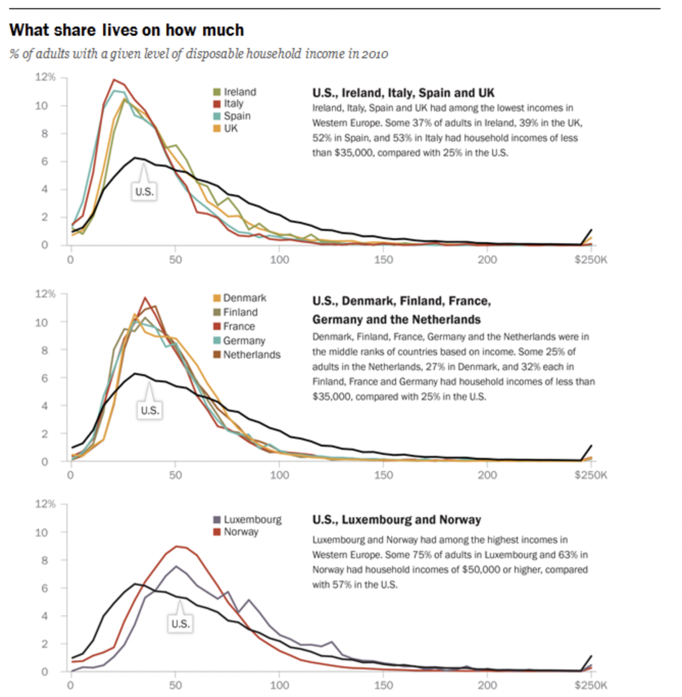</div>

::: {style="position: absolute; right: 0; bottom: 0; font-size: 0.5em; text-align: right;"}
[@pew2017westerneurope]
:::
:::


---

## Normal Probability Distribution

. . .

:::: {.columns}
::: {.column width="50%"}
1. Symmetrical about its mean
:::

::: {.column width="50%"}
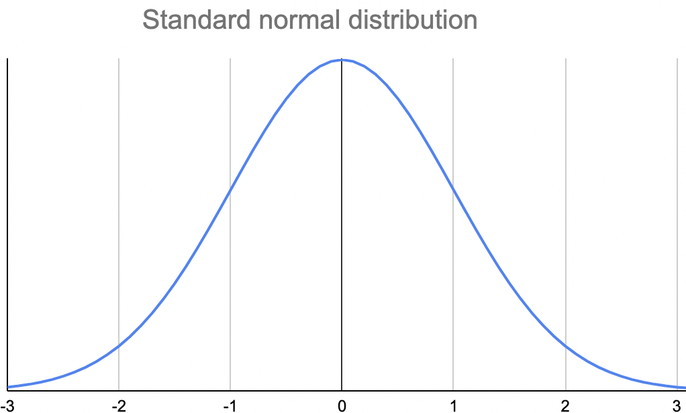{style="max-height: 55vh; width: auto;"}
:::
::::

---

## Normal Probability Distribution

:::: {.columns}
::: {.column width="50%"}
1. Symmetrical about its mean

::: {.fragment style="font-size: 0.9em;"}
- same amount of data above/below the mean <span class="fragment">→ [***mean = mode = median***]{style="color: #1f4e79;"}</span>
:::

::: {.fragment style="font-size: 0.9em;"}
- data is distributed in the same way above/below the mean
:::
:::

::: {.column width="50%"}
{style="max-height: 50vh; width: auto;"}
:::
::::

---

## Normal Probability Distribution

:::: {.columns}
::: {.column width="50%"}
1. Symmetrical about its mean
:::

::: {.column width="50%"}
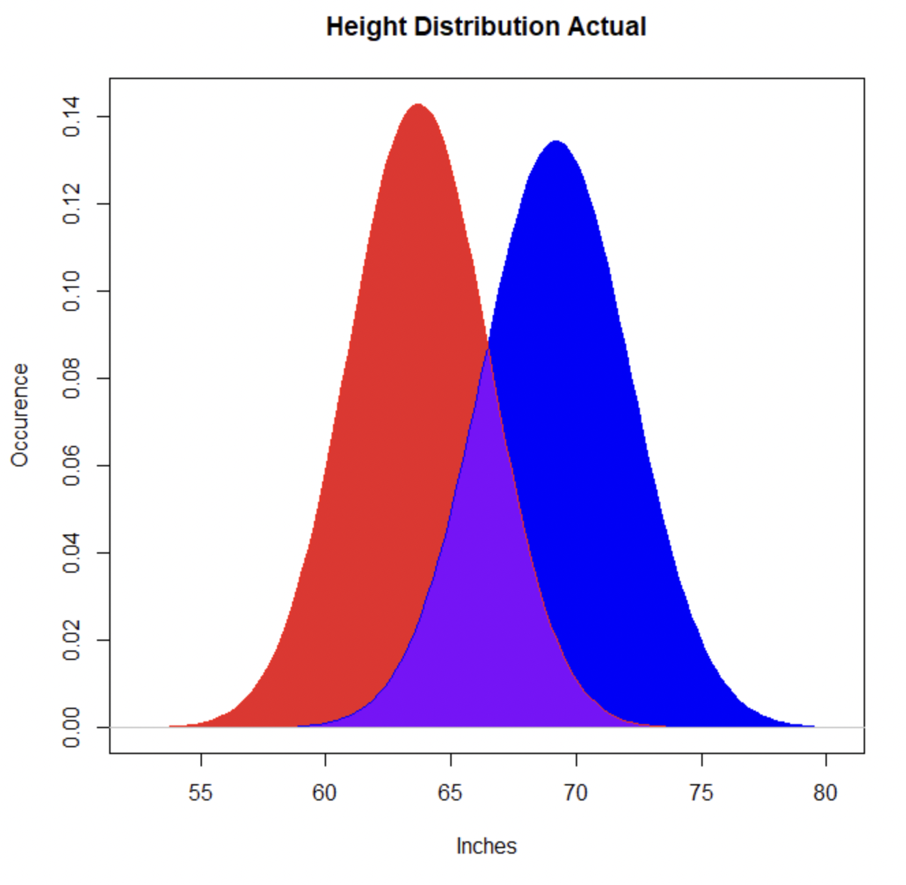{style="max-height: 62vh; width: auto;"}
:::
::::

---

## Normal Probability Distribution

:::: {.columns}
::: {.column width="50%"}
1. Symmetrical about its mean
2. [Predictable area under the curve, within specified distances from the mean]{.fragment fragment-index=2}
:::

::: {.column width="50%"}
::: {.fragment fragment-index=1}
{style="max-height: 30vh; width: auto;"}

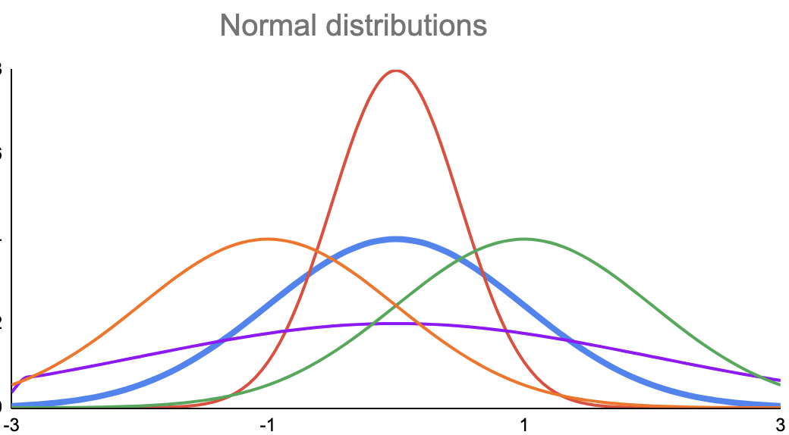{style="max-height: 30vh; width: auto;"}
:::
:::
::::

---

## Normal Probability Distribution

:::: {.columns}
::: {.column width="50%"}
1. Symmetrical about its mean
2. Predictable area under the curve, within specified distances from the mean <span class="fragment">↴</span>

::: {.incremental style="font-size: 0.68em;"}
- Start with the mean
- 68% of data within 1 SD of the mean
- 95%+ of data within 2 SDs of the mean
- 99%+ of data within 3 SDs of the mean
:::

::: {.fragment style="font-size: 0.85em;"}
&emsp;&emsp;→ [68-95-99 rule]{.hl2}
:::
:::

::: {.column width="50%"}
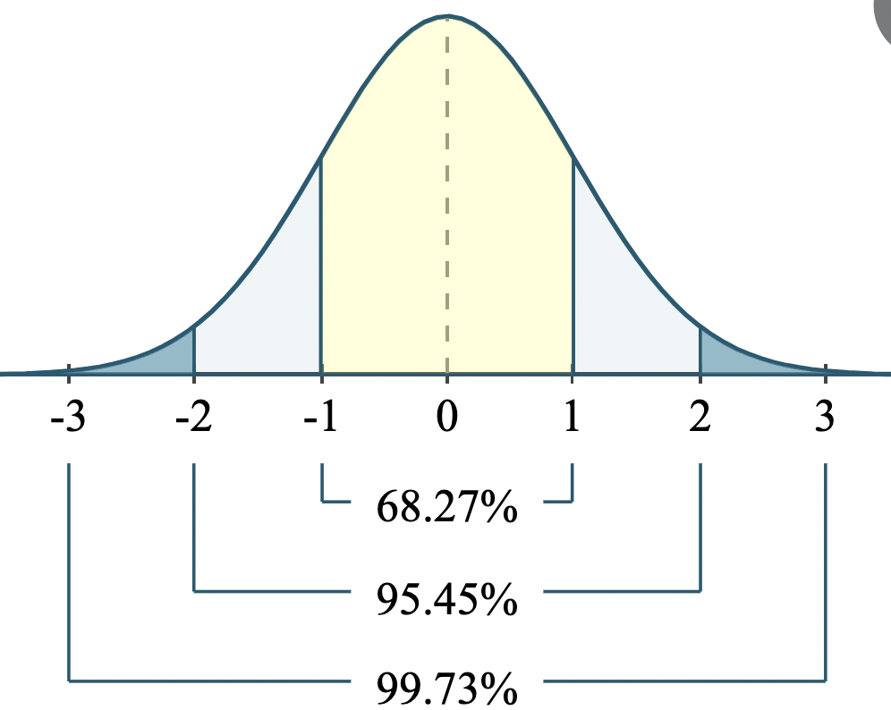{style="max-height: 55vh; width: auto;"}
:::
::::

---

# Back to real data…

---

## Frequency distributions {style="font-size: 0.75em;"}

:::: {.columns}
::: {.column width="48%"}
::: {.fragment fragment-index=1}
**Frequency distribution:** The frequency of each value of a particular variable.
:::

::: {.fragment fragment-index=2}
&emsp;Normally distributed? <span class="fragment" data-fragment-index="3">→ *NO NECESSARILY*</span>
:::

::: {.fragment fragment-index=4}
Example of a variable that would *not* be normally distributed?
:::

::: {.fragment fragment-index=6}
How common are normal distributions among social science data?
:::

::: {.fragment fragment-index=7 style="text-align: center;"}
***Real data is rarely normally distributed!***
:::

::: {.fragment fragment-index=8}
Why do we focus on normal distributions? <span class="fragment" data-fragment-index="9">↴</span>
:::

::: {.fragment fragment-index=9}
&emsp;&emsp;**Central Limit Theorem** [(Thursday)]{.fragment}
:::
:::

::: {.column width="52%"}
::: {.fragment fragment-index=5}
{style="max-height: 58vh; width: auto;"}

::: {style="font-size: 0.65em; text-align: center;"}
[@pew2017westerneurope]
:::
:::
:::
::::

---

## Reading Prompt UPDATE

Update your response, based on what you learned in lecture today:

In your own words, describe what it means when data is **normally distributed.**

# Central Limit Theorem

---

## Reading Prompt (Thursday)

In your own words: What is the Central Limit Theorem and what does it allow us to accomplish?

---

## Announcements

:::{.incremental}
- Midterm updates: Due this Friday (Fri Oct 23)
- Paid political internships: Due next Friday (Fri Oct 30)
  - Info session today!
- Honors program application: Due in two weeks (Fri Nov 6)
- Today: Wrap up probability (Central Limit Theorem)
- Thurs: Begin bivariate hypothesis tests (*Fundamentals* Ch 9)
:::

--- 


## Recap: Statistical Inference and Normal Distribution {style="font-size: 0.90em;"}

[GOAL of statistical inference:]{.hl2} Infer what we can about the [whole population]{.hl} based on what we **know with certainty** about a [sample population]{.hl}.

:::{.incremental}
- **Normal distribution**
  - Symmetrical about its mean
  - Predictable area under the curve, within specified distances from the mean [([68-95-99]{.hl2} rule)]{.fragment}

- **Frequency distribution** is what we see in our actual sample (*n*)
  - calculate mean, variance, standard deviation
  - probably not **normally distributed**

- **Sample distribution** is what we would see if we could repeat our sample (*n*) an infinite number of times and plot the mean of our sample each time → [[Central Limit Theorem]{.hl}]{.fragment}
<!--.
  - hypothetical exercise; accepted as true (theorem)
  - normally distributed
  - the mean would be the same as the *real-world* mean
  - use this idea to calculate the standard error
-->
:::

---

## Central Limit Theorem

[GOAL of statistical inference:]{.hl2} Infer what we can about the [whole population]{.hl} based on what we **know with certainty** about a [sample population]{.hl}.

. . .

[Central Limit Theorem (core underlying principle):]{.hl2} A large, properly drawn [sample]{.hl} will resemble the [population]{.hl} from which it is drawn [@wheelan2013naked, p. 128].

. . .

[Central Limit Theorem (specifically):]{.hl2} [The distribution of a collection of [sample means]{.hl} (from a collection of samples) tends to be **normal**, even when the frequency distribution from which the average is calculated is non-normal.]{.fragment}

. . .

***Let's look at an example from rolling the dice...***

---

## Central Limit Theorem [@kellstedt2022fundamentals] {style="font-size: 0.7em;"}

:::: {.columns}
::: {.column width="50%"}

::: {.incremental}
- Dice roll #1 (*n* = 600)
  - Sample Mean: 3.47
  - Sample Standard Deviation: 1.71
    - If we had more cases → SD lower
    - If we had fewer cases → SD higher
- Dice role #2 (*n* = 600)
  - Sample's mean: 3.57
- **Hypothetically:** 
  - If we roll the dice (n=600) *an infinite number of times*, the distribution of the sample means (the **sampling distribution**) would be normally distributed.
  - Mean of the sampling distribution would be equal to the true population mean.
- The **variance/standard deviation** of that **sample distribution** is dictated by the size of our **sample** (*n*) <span class="fragment">⤴ (see right)</span>
:::
:::

::: {.column width="50%"}
::: {.fragment}
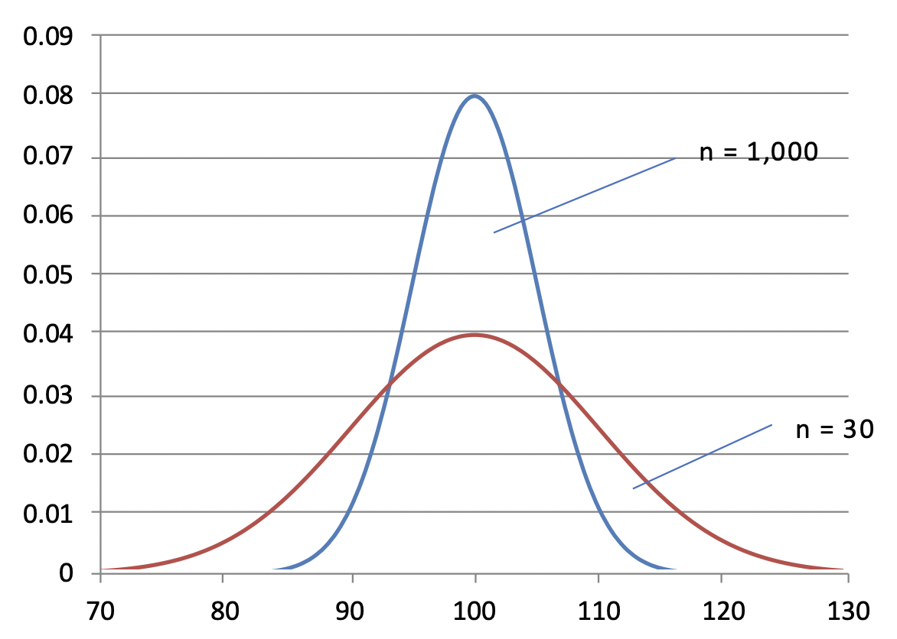{style="max-height: 38vh; width: auto;"}
:::

::: {.fragment}
- Increasing **sample size** reduces variance of the [sampling distribution]{style="color: #4472c4; font-weight: bold;"}, making our estimates of the population more accurate.
:::

::: {.fragment}
- Standard deviation of the sampling distribution becomes the **"standard error of the mean"** of our observed sample.
:::
:::
::::

This is all a hypothetical exercise.

---

## Central Limit Theorem



<!--
:::{.incremental}
- **Sample distribution** is what we would see if we could repeat our sample (*n*) an infinite number of times and plot the mean of our sample each time → [[Central Limit Theorem]{.hl}]{.fragment}
  - hypothetical exercise; accepted as true (theorem)
  - normally distributed
  - the mean would be the same as the *real-world* mean
  - use this idea to calculate the standard error
:::
-->

---

## Central Limit Theorem {style="font-size: 0.85em;"}

**KEY TAKE-AWAY POINTS:**

:::: {.columns}
::: {.column width="42%"}
::: {style="text-align: center;"}
**Frequency distribution**<br>[(our sample)]{style="font-size: 0.8em;"}
:::
:::

::: {.column width="16%"}
::: {style="text-align: center;"}
[⟶]{style="font-size: 1.6em; color: #4472c4;"}
:::
:::

::: {.column width="42%"}
::: {style="text-align: center;"}
**Sample distribution**<br>[(infinite samples → info about the real population)]{style="font-size: 0.8em;"}
:::
:::
::::

::: {.incremental}
- If we can **envision an infinite number of random samples** and plot our means for each of these random samples, those sample means would be **distributed normally**. Furthermore, the mean of the sampling distribution would be equal to the **true population mean**.
- It allows us to calculate our **standard error of the mean**.
- **Standard error** is what we use to quantify our level of *uncertainty* about how well we can infer information about the [population]{.hl} based on what we know/observe about our [sample]{.hl}.
- The larger our [sample]{.hl} is, the less uncertain we are about the [population]{.hl}.
:::

---

## Why do we care about the Central Limit Theorem? {style="font-size: 0.8em;"}

:::: {.columns}
::: {.column width="58%"}
::: {.fragment fragment-index=1}
[Goal:]{style="color: #2e75b6; font-weight: bold;"} Learn what we can about the underlying population, based on what we know with certainty about our sample. <span class="fragment note" data-fragment-index="2">→ [***mean***]{.hl2} *of the underlying population*</span>
:::

::: {.fragment fragment-index=3}
[In practice,]{style="color: #2e75b6; font-weight: bold;"} we use:
:::

<ul>
<li class="fragment" data-fragment-index="4">The information we have in our sample
<ul><li class="fragment" data-fragment-index="5">(<strong>mean, standard deviation, sample size</strong>)</li></ul></li>
<li class="fragment" data-fragment-index="6">The central limit theorem
<ul><li class="fragment" data-fragment-index="7">(<strong>normal sampling distribution; 68-95-99 rule</strong>)</li></ul></li>
</ul>

::: {.fragment fragment-index=9}
[In order to]{style="color: #2e75b6; font-weight: bold;"}: Identify the range that we expect the true population's mean to fall within, to a certain degree of confidence. <span class="fragment note" data-fragment-index="10">→ [***standard error***]{.hl2} *of the mean*</span>
:::
:::

::: {.column width="42%"}
::: {.fragment fragment-index=8}
{style="max-height: 48vh; width: auto;"}
:::
:::
::::

---

## Calculating standard errors

::: {.fragment}
:::: {.columns style="align-items: center;"}
::: {.column width="50%"}
$$\text{S.D.} = \sqrt{\frac{\sum_{i=1}^{n}\left(Y_i - \bar{Y}\right)^2}{n-1}}$$
:::
::: {.column width="50%"}
[Standard deviation:]{.hl} a statistical measure of the dispersion of a variable around its mean
:::
::::
:::

::: {.fragment}
:::: {.columns style="align-items: center;"}
::: {.column width="50%"}
$$\text{S.E.} = \frac{SD}{\sqrt{n}}$$
:::
::: {.column width="50%"}
[Standard error of the mean:]{.hl2} the standard deviation of the sampling distribution of sample means
:::
::::
:::

---

## Calculating standard errors [@kellstedt2022fundamentals] {style="font-size: 0.85em;"}

:::: {.columns}
::: {.column width="48%"}

::: {.incremental}
- Dice roll: *n* = 600
- Sample Mean: 3.47
- Sample Standard Deviation (SD): 1.71
:::

::: {.fragment}
$$\text{S.E.} = \frac{SD}{\sqrt{n}} = \frac{1.71}{\sqrt{600}}$$
:::

::: {.fragment}
- Standard Error: 0.07
:::

::: {.fragment}
- What do ***do*** with a standard error?
:::
:::

::: {.column width="52%"}
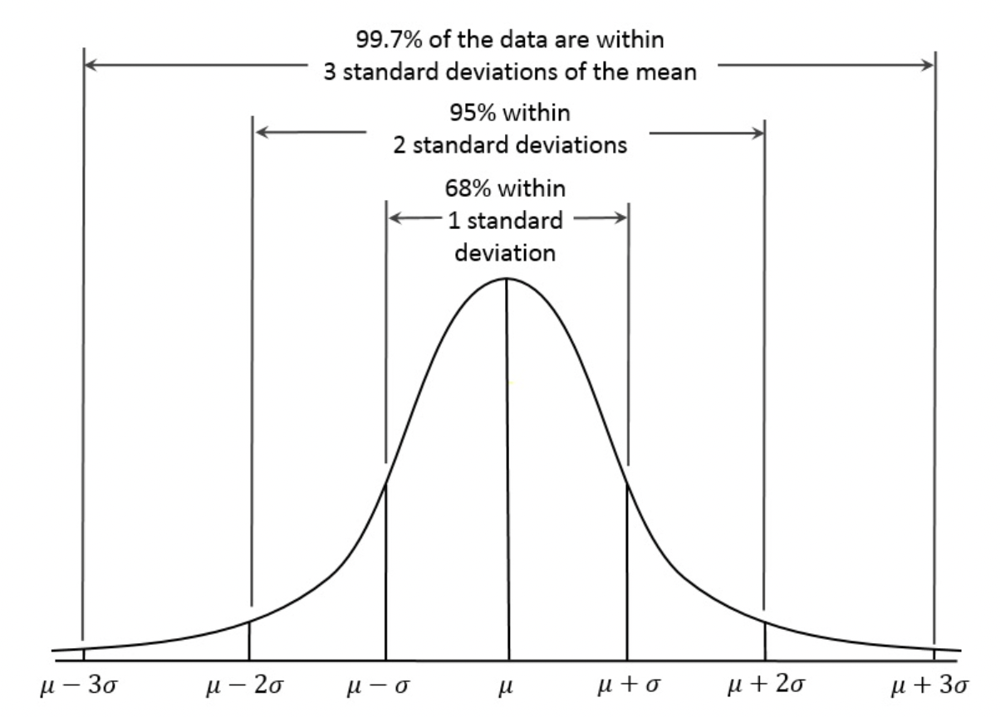{style="max-height: 42vh; width: auto;"}

::: {.fragment}
↳ Capture how *confident* we are that the mean from our [sample]{.hl} represents the mean from the [whole population]{.hl}.
:::
:::
::::

---

## Confidence Intervals [@kellstedt2022fundamentals] {style="font-size: 0.85em;"}

:::: {.columns}
::: {.column width="45%"}

- Sample Mean: 3.47
- Standard Error: 0.07

::: {.fragment}
What is the range of the possible mean scores that will capture [68%]{.hl2} of the mean scores that you get when you roll the dice (*n*=600) an infinite number of times?
:::
:::

::: {.column width="55%"}
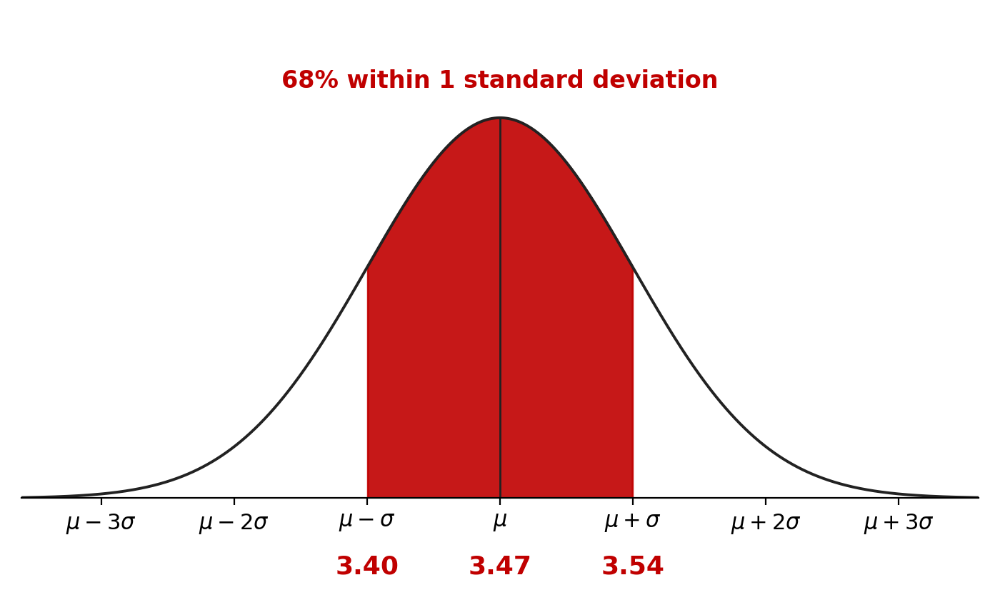{style="max-height: 40vh; width: auto;"}
:::
::::

::: {.tight style="text-align: center;"}
::: {.fragment}
mean ($\bar{Y}$ or $\mu$) from your sample $\pm$ standard error ($\sigma$) =
:::

::: {.fragment}
3.47 $\pm$ 0.07 =
:::

::: {.fragment}
[3.40 – 3.54]{style="border: 2px solid #C00000; border-radius: 50%; padding: 0 0.6em;"} <span class="fragment">&ensp;→ [68%]{.hl2}</span>
:::

::: {.fragment}
[*I am confident (68% level) that the real population mean lies between 3.4 and 3.54.*]{style="color: #C00000;"}
:::
:::


---

## Confidence Intervals [@kellstedt2022fundamentals] {style="font-size: 0.85em;"}

:::: {.columns}
::: {.column width="45%"}

- Sample Mean: 3.47
- Standard Error: 0.07

::: {}
What is the range of the possible mean scores that will capture [68%]{.hl2} of the mean scores that you get when you roll the dice (*n*=600) an infinite number of times?
:::
:::

::: {.column width="55%"}
{style="max-height: 40vh; width: auto;"}
:::
::::

::: {.tight style="text-align: center;"}
::: {}
mean ($\bar{Y}$ or $\mu$) from your sample $\pm$ standard error ($\sigma$) =
:::

::: {}
3.47 $\pm$ 0.07 =
:::

::: {}
[3.40 – 3.54]{style="border: 2px solid #C00000; border-radius: 50%; padding: 0 0.6em;"} <span>&ensp;→ [68%]{.hl2}</span>
:::

::: {}
[*16% chance the pop. mean is less than 3.4 and 16% chance it is greater than 3.54.*]{style="color: #C00000;"}
:::
:::

---

## Confidence Intervals [@kellstedt2022fundamentals] {style="font-size: 0.85em;"}

:::: {.columns}
::: {.column width="45%"}

- Sample Mean: 3.47
- Standard Error: 0.07

What is the range of the possible mean scores that will capture [95%]{.pu} of the mean scores that you get when you roll the dice (*n*=600) an infinite number of times?
:::

::: {.column width="55%"}
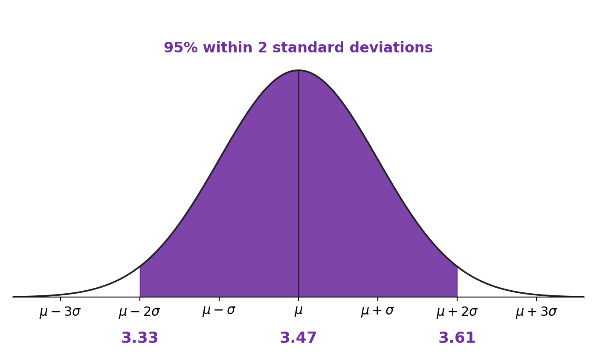{style="max-height: 40vh; width: auto;"}
:::
::::

::: {.tight style="text-align: center;"}
::: {.fragment}
mean ($\bar{Y}$ or $\mu$) from your sample $\pm$ 2 standard errors ($\sigma$) =
:::

::: {.fragment}
3.47 $\pm$ 2 x 0.07 = 3.47 $\pm$ 0.14
:::

::: {.fragment}
[3.33 – 3.61]{style="border: 2px solid #7030A0; border-radius: 50%; padding: 0 0.6em;"} <span class="fragment">&ensp;→ [95%]{.pu}</span>
:::

::: {.fragment}
[*I am confident (95% level) that the real population mean lies between 3.33 and 3.61.*]{style="color: #7030A0;"}
:::
:::

---

## Confidence Intervals [@kellstedt2022fundamentals] {style="font-size: 0.85em;"}

:::: {.columns}
::: {.column width="45%"}

- Sample Mean: 3.47
- Standard Error: 0.07

What is the range of the possible mean scores that will capture [95%]{.pu} of the mean scores that you get when you roll the dice (*n*=600) an infinite number of times?
:::

::: {.column width="55%"}
{style="max-height: 40vh; width: auto;"}
:::
::::

::: {.tight style="text-align: center;"}
mean ($\bar{Y}$ or $\mu$) from your sample $\pm$ 2 standard errors ($\sigma$) =

3.47 $\pm$ 2 x 0.07 = 3.47 $\pm$ 0.14

[3.33 – 3.61]{style="border: 2px solid #7030A0; border-radius: 50%; padding: 0 0.6em;"} &ensp;→ [95%]{.pu}

[*2.5% chance the pop. mean is less than 3.33 and 2.5% chance it is greater than 3.61.*]{style="color: #7030A0;"}
:::

---

## Confidence Intervals [@kellstedt2022fundamentals] {style="font-size: 0.85em;"}

:::: {.columns}
::: {.column width="45%"}
- Sample Mean: 3.47
- Standard Error: 0.07

What is the range of the possible mean scores that will capture [99%]{style="color: #00B050; font-weight: 700;"} of the mean scores that you get when you roll the dice (*n*=600) an infinite number of times?
:::

::: {.column width="55%"}
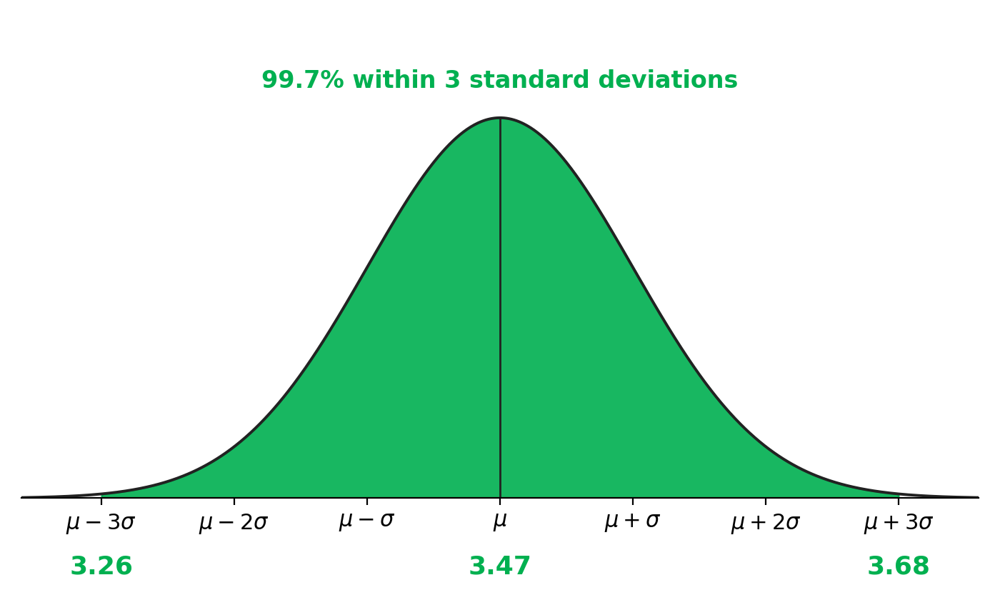{style="max-height: 40vh; width: auto;"}
:::
::::

::: {.tight style="text-align: center;"}
::: {.fragment}
mean ($\bar{Y}$ or $\mu$) from your sample $\pm$ 3 standard errors ($\sigma$) =
:::

::: {.fragment}
3.47 $\pm$ 3 x 0.07 = 3.47 $\pm$ 0.21
:::

::: {.fragment}
[3.26 – 3.68]{style="border: 2px solid #00B050; border-radius: 50%; padding: 0 0.6em;"} <span class="fragment">&ensp;→ [99%]{style="color: #00B050; font-weight: 700;"}</span>
:::

::: {.fragment}
[*I am confident (99% level) that the real population mean lies between 3.26 and 3.68.*]{style="color: #00B050;"}
:::
:::

---

## Confidence Intervals [@kellstedt2022fundamentals] {style="font-size: 0.85em;"}

:::: {.columns}
::: {.column width="45%"}
- Sample Mean: 3.47
- Standard Error: 0.07

What is the range of the possible mean scores that will capture [99%]{style="color: #00B050; font-weight: 700;"} of the mean scores that you get when you roll the dice (*n*=600) an infinite number of times?
:::

::: {.column width="55%"}
{style="max-height: 40vh; width: auto;"}
:::
::::

::: {.tight style="text-align: center;"}
mean ($\bar{Y}$ or $\mu$) from your sample $\pm$ 3 standard errors ($\sigma$) =

3.47 $\pm$ 3 x 0.07 = 3.47 $\pm$ 0.21

[3.26 – 3.68]{style="border: 2px solid #00B050; border-radius: 50%; padding: 0 0.6em;"} &ensp;→ [99%]{style="color: #00B050; font-weight: 700;"}

[*<1% chance the pop. mean is less than 3.26 and <1% chance it is greater than 3.68.*]{style="color: #00B050;"}
:::

---

## Note about sample sizes {style="font-size: 0.85em;"}

[Central Limit Theorem (core underlying principle):]{.hl2} A large, properly drawn [sample]{.hl} will resemble the [population]{.hl} from which it is drawn [@wheelan2013naked, p. 128].

::: {.incremental}
- The greater the random [sample size (n)]{.hl} of your dataset, the [less uncertainty]{.hl2} (and *smaller "confidence intervals"*) you will have about the [real population]{.hl}
  - Rule of thumb: sample size must be at least $n$ = 30 [@wheelan2013naked, p. 135].
- If our samples were both random, the size of the sample (relative to the population) would not a problem.
- But: Lot of conditions undermine the randomness of real-world survey data.
  - WVS: Its really complicated to get a truly "random" sample. [But the statistical models (and `R`) still assume that you are dealing with a random sample.]{.fragment}
    - Bolivia: 12m (n=2067)
    - China: 1.4b (n=3036)
- Your models don't know that these limits exist [→ more confidence than may be appropriate.]{.fragment}
:::

## Still super confused?

. . .

Grasping these concepts often takes iteration over years.

. . .

What you **need** to know:

:::{.incremental}
- [Central Limit Theorem (core underlying principle):]{.hl2} A large, properly drawn [sample]{.hl} will resemble the [population]{.hl} from which it is drawn [@wheelan2013naked, p. 128].
- We take information that we observe in our [sample]{.hl}[---sample size ($n$), your variable's mean and standard deviation---]{.fragment} [to calculate how much uncertainty we have that the real [population's]{.hl} mean resembles the sample mean ([standard error]{.hl2}).]{.fragment}
- We report that level of uncertainty in the form of [confidence intervals.]{.hl2}
:::

# Example: Political Ideology
Follow along with one of your variables!

---

## Ex: Political Ideology {style="font-size: 0.9em;"}

[Follow along with one of your variables!]{.slide-sub}

:::: {.columns}
::: {.column width="40%"}
::: {.fragment}
1\. Look at variable; make sure "missing" data is filtered out.
:::
:::

::: {.column width="60%"}
::: {style="font-size: 0.85em;"}
::: {.fragment}
```{.r}
# Orig variable: V241177
#1: extremely liberal
#4: moderate / middle of the road
#7: extremely conservative
table(anes_data$V241177)
```
```
  -9   -4    1    2    3    4    5    6    7   99
  67    3  250  819  543 1187  594 1030  309  719
```
```{.r}
anes_data$ideology <- anes_data$V241177
anes_data$ideology[anes_data$V241177 > 7] <- NA
anes_data$ideology[anes_data$V241177 < 0] <- NA
table(anes_data$ideology)
```
```
   1    2    3    4    5    6    7
 250  819  543 1187  594 1030  309
```
<!--
anes_data <- anes_data %>%
  rename(ideology_scale = V241177) %>%
  filter(ideology_scale > 0) %>%
  filter(ideology_scale < 8)
-->

::: {style="font-size: 0.8em; text-align: center;"}
ANES 2024 Time Series [@anes2024tsdata].
:::
:::
:::
:::
::::

---

## Ex: Political Ideology {style="font-size: 0.9em;"}

[Follow along with one of your variables!]{.slide-sub}

:::: {.columns}
::: {.column width="40%"}
[1\. Look at variable; make sure "missing" data is filtered out.]{.past}

::: {.fragment fragment-index=1}
2\. Look at the frequency distribution within the sample.
:::
:::

::: {.column width="60%"}
::: {.fragment fragment-index=2}
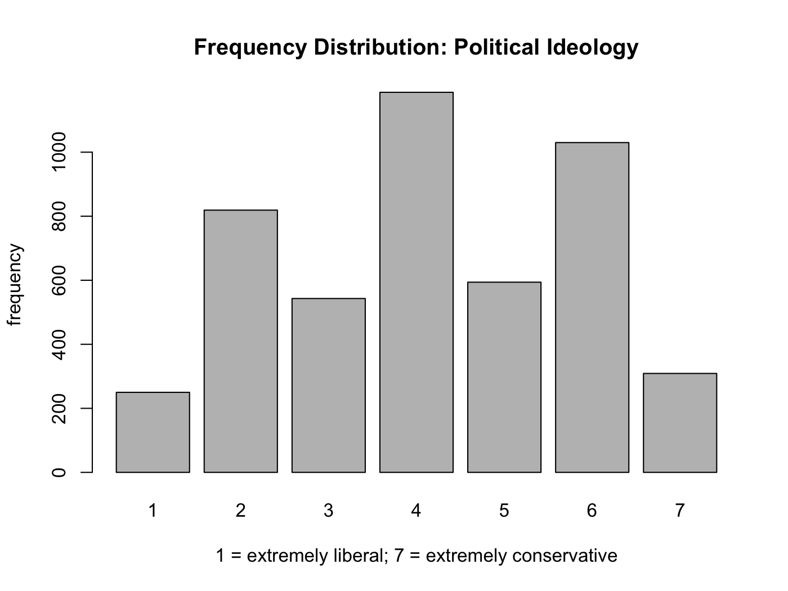{style="max-height: 45vh; width: auto;"}
:::

::: {.fragment fragment-index=2 style="font-size: 0.85em;"}
```{.r}
barplot(table(anes_data$ideology),
        main="Frequency Distribution: Political Ideology",
        xlab="1 = extremely liberal; 7 = extremely conservative",
        ylab="frequency")
```
:::
:::
::::

---

## Ex: Political Ideology {style="font-size: 0.9em;"}

[Follow along with one of your variables!]{.slide-sub}

:::: {.columns}
::: {.column width="40%"}
[1\. Look at variable; make sure "missing" data is filtered out.]{.past}

[2\. Look at the frequency distribution within the sample.]{.past}

::: {.fragment}
3\. Look at the mean and standard deviation of the sample.
:::
:::

::: {.column width="60%"}
{style="max-height: 45vh; width: auto;"}

::: {.r-stack style="font-size: 0.85em;"}
::: {.fragment .fade-in-then-out style="width: 100%;"}
```{.r}
mean(anes_data$ideology)
## [1] NA
```
:::

::: {.fragment style="width: 100%;"}
```{.r}
mean(anes_data$ideology, na.rm=T)
## 4.137363
sd(anes_data$ideology, na.rm=T)
## [1] 1.687654
```
:::
:::
:::
::::

---

## Ex: Political Ideology {style="font-size: 0.9em;"}

[Follow along with one of your variables!]{.slide-sub}

:::: {.columns}
::: {.column width="40%"}
[1\. Look at variable; make sure "missing" data is filtered out.]{.past}

[2\. Look at the frequency distribution within the sample.]{.past}

[3\. Look at the mean and standard deviation of the sample.]{.past}

::: {.fragment}
4\. What is the mean of the population?
:::
:::

::: {.column width="60%"}
{style="max-height: 45vh; width: auto;"}

::: {style="font-size: 0.85em;"}
```{.r}
mean(anes_data$ideology, na.rm=T)
## 4.137363
sd(anes_data$ideology, na.rm=T)
## [1] 1.687654
```
:::
:::
::::

---

## Ex: Political Ideology {style="font-size: 0.9em;"}

[Follow along with one of your variables!]{.slide-sub}

:::: {.columns}
::: {.column width="40%"}
[1\. Look at variable; make sure "missing" data is filtered out.]{.past}

[2\. Look at the frequency distribution within the sample.]{.past}

[3\. Look at the mean and standard deviation of the sample.]{.past}

4\. What is the mean of the population? &ensp;[*I'll never know!*]{.hl2}
:::

::: {.column width="60%"}
{style="max-height: 45vh; width: auto;"}

::: {style="font-size: 0.85em;"}
```{.r}
mean(anes_data$ideology, na.rm=T)
## 4.137363
sd(anes_data$ideology, na.rm=T)
## [1] 1.687654
```
:::
:::
::::

---

## Ex: Political Ideology {style="font-size: 0.9em;"}

[Follow along with one of your variables!]{.slide-sub}

:::: {.columns}
::: {.column width="40%"}
[1\. Look at variable; make sure "missing" data is filtered out.]{.past}

[2\. Look at the frequency distribution within the sample.]{.past}

[3\. Look at the mean and standard deviation of the sample.]{.past}

[4\. What is the mean of the population? &ensp;*I'll never know!*]{.past}
:::

::: {.column style="width: 60%; margin-top: -3.2em;"}
::: {.fragment}
5\. Use the sample to calculate the range within which I can be 95% confident that the population's mean will reside.
:::

::: {style="font-size: 1.05em;"}
```{.r .line-frags}
# Create the objects I need:
var_mean <- mean(anes_data$ideology, na.rm=T)
var_sd <- sd(anes_data$ideology, na.rm=T)
n <- sum(table(anes_data$ideology))
var_se <- var_sd / sqrt(n)
```

```{.r .line-frags}
# Calculate 95% confidence intervals
lower <- var_mean - var_se*2
upper <- var_mean + var_se*2
conf_interval_95 <- c(lower, var_mean, upper)
print(conf_interval_95)
## [1] 4.088295 4.137363 4.186430
```
:::

::: {.tight}
. . .

&rarr; [[I am confident (95% level) that the real population mean lies between 4.088 and 4.186.]{.hl2}]{.fragment}

. . .

&rarr; [[2.5% chance the true population mean is <4.09; 2.5% chance it is >4.19.]{.hl2}]{.fragment}
:::

:::
::::


# Class Lab

---

## Class Lab {style="font-size: 0.75em;"}

:::: {.columns}
::: {.column width="55%"}
::: {.fragment}
**Things you should already have done for your IV and DV (last weekly assignment):**
:::

::: {.incremental}
1. Rename your variable
2. Change "missing" data to NAs
3. Transform your variable IF:
    - Your ordinal variable is not in order
    - Your variable is categorical:
      - *Make it binary*[: ex: Muslim (1) or not (0)]{.fragment}
4. WVS: Subset your data to the 1-3 countries you want to focus on
:::
:::

::: {.column width="45%"}
::: {.fragment}
[Next Tasks:]{.hl2}
:::

::: {.incremental}
- Create a plot of your variables' frequency distribution ([Slide 41]{.gr1})
- Calculate your 95% confidence intervals---e.g., the range within which I can be 95% confident that the population's mean will reside ([Slide 45]{.gr1}) 
- **Interpretation:** What does this mean for your understanding about your variables? Write 2-3 sentences reporting what you've learned about your variables (IV and DV), based on these new pieces of information? 
:::

::: {.fragment}
**Resources:** Slides (Wk9:Probability, Recoding Workshop.pptx).
:::
:::
::::

---

## For Tuesday:

[*Fundamentals* Ch 9, "Bivariate Hypothesis Testing."](https://skdreier.github.io/POLS2140/) — see the full schedule on the syllabus.

---

## TL;DR {style="font-size: 0.9em;"}

- **Statistical inference** uses what we *know* about a sample to draw uncertain conclusions about the whole population — which only works if we know how the sample was selected (random?) and whether it's large enough.
- A **normal distribution** is symmetrical about its mean (mean = mode = median) and follows the **68-95-99 rule** — but real-world frequency distributions are rarely normal.
- The **Central Limit Theorem**: if we could draw infinitely many random samples, their means would be normally distributed around the true population mean — which lets us calculate a **standard error** (S.E. = SD / √n).
- A **confidence interval** is the sample mean ± 1, 2, or 3 standard errors (68%, 95%, 99% confidence) — e.g., dice rolls: 3.47 ± 2 × 0.07 = 3.33–3.61 at 95%. Larger samples → smaller standard errors → narrower intervals.

---

## References {.smaller}

::: {#refs}
:::
