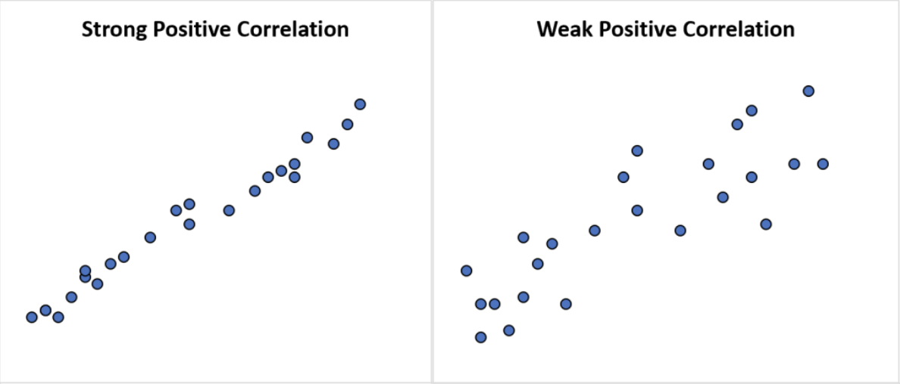
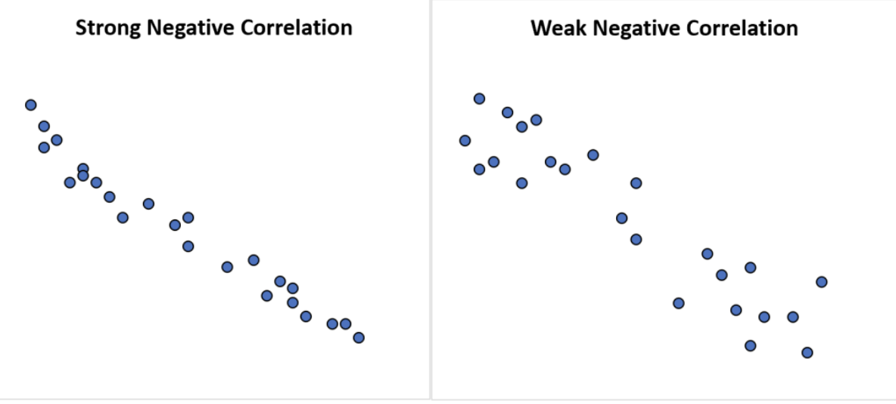
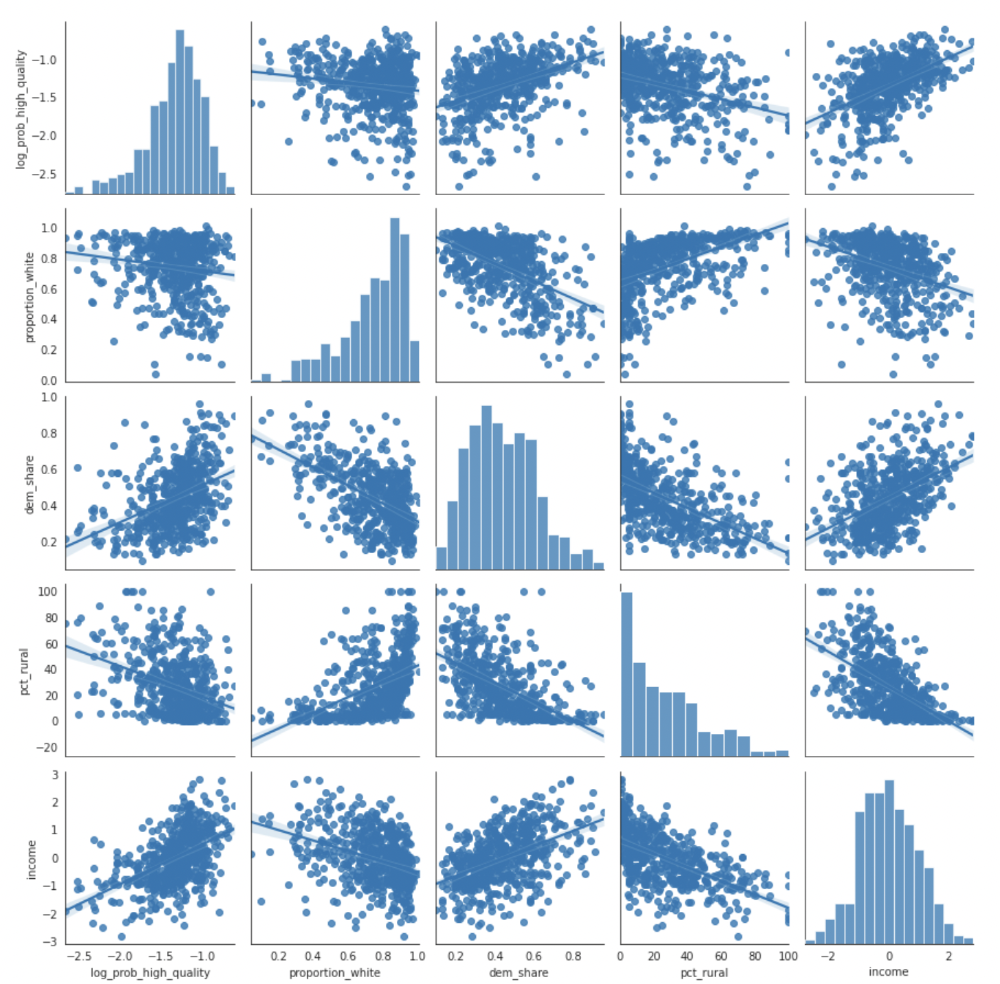
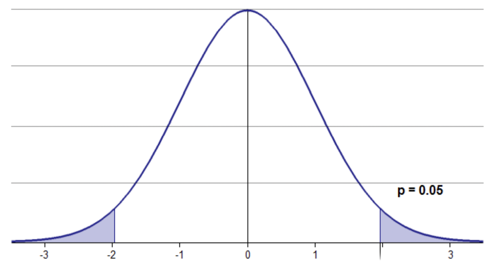
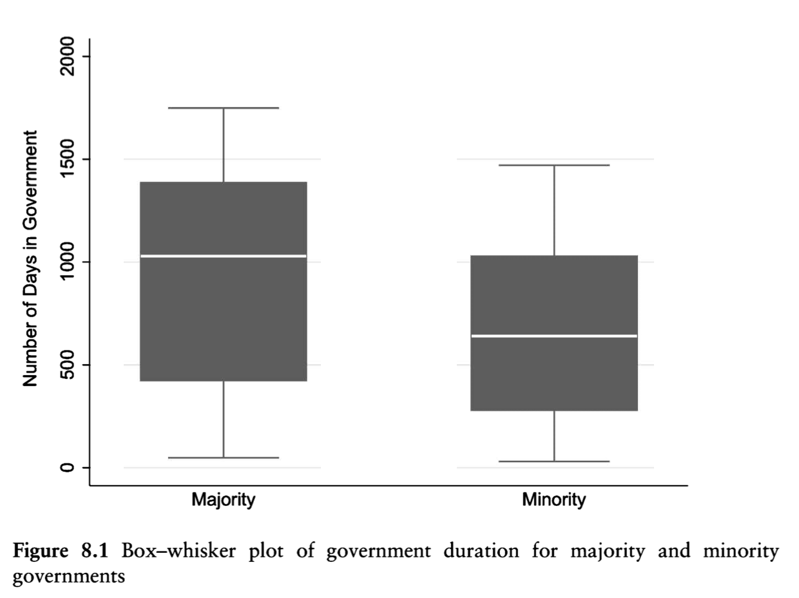
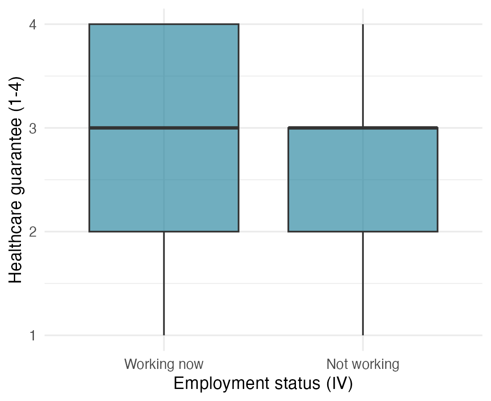
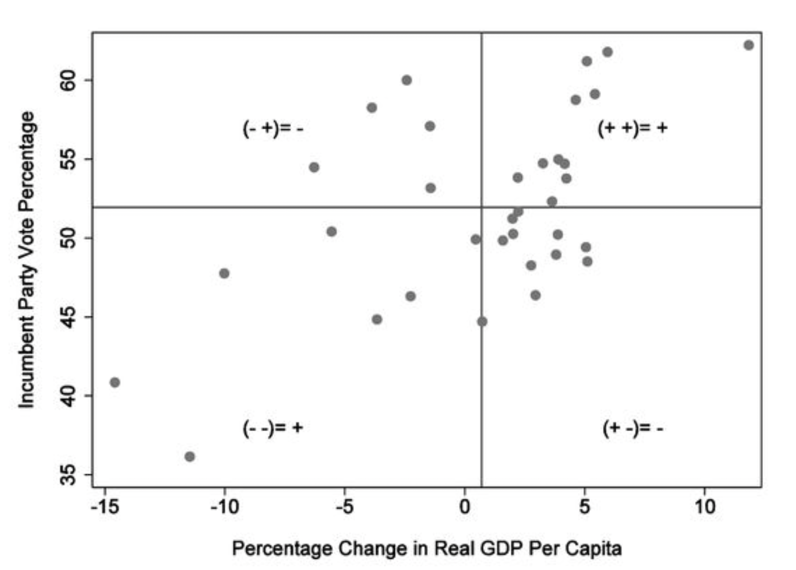
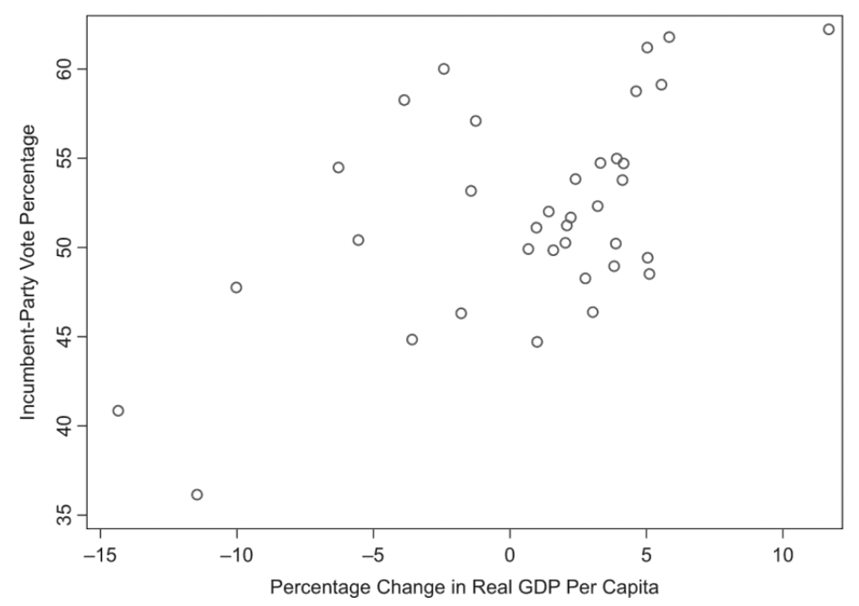

## Reminders and announcements

:::{.incremental}
- **Midterm updates:** [Due tomorrow (Oct 23)]{.hl2}
- **Paid political internships:** Due next Friday (Oct 30)
  - Info session: Monday 2:00-3:00p, SSCO 2060
- **Honors program:** Application due in two weeks (Nov 6)
- **Karla office hours:** Today 12:30-2:30
- **Class plan:**
  - Data News: Maryam Gauba
  - *Today:* Bivariate hypothesis tests (*Fundamentals* Ch 9)
  - *Tue:* Begin bivariate regression analysis
:::

<!-- Ian Reevy and James Padilla go on Tued -->

---

## Reading Prompt

In your own words: What is a **bivariate hypothesis test** and what does it accomplish? 

(Hang on to your response, we'll return to it later.)

---

## Recall: {.dim-past style="font-size: 0.9em;"}

```{=html}
<script src="dim-past.js"></script>
```

:::{.incremental}
- **GOAL of statistical inference:** Infer what we can about the whole [population]{.hl} based on what we **know with certainty** about a [sample population]{.hl}.
- **Central Limit Theorem (core underlying principle):** A large, properly drawn random [sample]{.hl} will resemble the [population]{.hl} from which it is drawn [@wheelan2013naked, p. 128].
- For a single variable, we inferred the **population's true mean**[, specifically the range within which the **population's true mean** would fall within (at the 95% confidence level).]{.fragment}
- **Today:** Are [two variables]{.hl} related?
:::


---

## Are two variables related? {style="font-size: 0.9em;"}

<!--**Covariance:** A statistical measure summarizing the general pattern of association (or lack thereof) between two [continuous variables.]{.hl}
-->

:::: {.columns}
::: {.column width="45%"}
{style="max-height: 28vh; width: auto;"}

::: {.fragment}
{style="max-height: 28vh; width: auto;"}
:::
:::

::: {.column width="55%"}
::: {.fragment}
{style="max-height: 62vh; width: auto;"}
:::
:::
::::


# $p$-values

## Bivariate Hypothesis tests {style="font-size: 0.8em;"}

:::: {.columns}
::: {.column width="66%"}

. . .

We don't want to accidentally (by chance) get a sample that doesn't reflect the real world.

. . .

**Compare:**

:::{.incremental}
- The [observed relationship between two variables (IV and DV) in sample data]{.hl} [ to]{.fragment} 
- What you would expect to observe if [the IV and DV were **NOT** related in the underlying population.]{.hl2}
:::

. . .

The **more different** the [empirically observed relationship]{.hl} is from [what we would expect if there were **not** a relationship]{.hl2}[, the **more confidence** we have that the two variables are related in the underlying population.]{.fragment}

. . .

[&rarr; Can you reject the **null hypothesis** (that there is no relationship)?]{style="white-space: nowrap;"}
:::

::: {.column width="34%"}
<!-- Population/sample circles, same graphic as 12_probability "Population and Samples" -->
<svg viewBox="0 0 300 300" style="width: 100%; max-height: 40vh;">
  <!-- Colors echo the text highlights: population = .hl2 maroon, sample = .hl teal -->
  <circle cx="150" cy="150" r="140" fill="#efcfc9"/>
  <text x="165" y="210" font-size="20" font-weight="bold" fill="#9a2515">Population</text>
  <circle cx="90" cy="110" r="45" fill="#a8d5e2"/>
  <text x="90" y="116" font-size="18" font-weight="bold" fill="#0b5568" text-anchor="middle">Sample</text>
</svg>
:::
::::

. . .


::: {.tight2 style="text-align: center;"}
**$p$-values** are the statistic that represents this logical exercise.
:::


<!--
## Objective

::: {style="text-align: center;"}
Are X and Y related?

[(causal hurdle #3)]{.note}
:::

. . .

**Covariance:** A statistical measure summarizing the general pattern of association (or lack thereof) between two continuous variables.

. . .

**Bivariate:** Two variables

. . .

→ [Can't evaluate confounding variables]{.hl2}

. . .

**Bivariate hypothesis tests** allow us to assess covariance statistically (rather than visually)
-->


## $p$-value: {style="font-size: 0.85em;"}

<!-- Every fragment on this slide has an explicit fragment-index so the
     right-column curve can appear right after the second bullet. -->
:::: {.columns}
::: {.column width="55%"}
::: {.compact}

::: {.fragment fragment-index=2}
- The $p$robability that we would see the relationship that we are finding because of random chance.
:::

::: {.fragment fragment-index=3}
- Or: The probability we would see the observed relationship in our [sample data]{.hl} even if there was no relationship in the unobserved [population]{.hl2}.
:::

::: {.fragment fragment-index=5}
- Because the $p$-value is a probability: [{0, 1}]{.hl2}
:::
:::
:::

::: {.column width="45%"}
::: {.fragment fragment-index=4}
{style="width: 100%; max-height: 45vh; object-fit: contain; margin-top: 1.5em;"}
:::
:::
::::

::: {.fragment fragment-index=6}
If we want evidence to support for our hypothesis, would we want the $p$-value to be high or low?
:::


---

## $p$-value: {style="font-size: 0.78em;"}

:::: {.columns}
::: {.column width="55%"}

[The **lower the $p$-value**, the **greater confidence** we have that there is a real relationship between our two variables.]{.hl2}

::: {.fragment fragment-index=1}
> **statistical significance:** A conclusion, based on the observed data, that the relationship between two variables is not due to random chance, and therefore exists in the broader population.
:::

<!-- Explicit fragment-index on every step so the 0.05 note can appear after 0.01. -->
::: {.tight .fragment fragment-index=2}
What $p$-values are low enough to demarcate statistical significance (allowing us to reject the null hypothesis)?
:::

::: {.compact}
::: {.fragment fragment-index=3}
- 0.10
:::

::: {.fragment fragment-index=4 style="white-space: nowrap;"}
- 0.05 [→ Relationship between X and Y is statistically significant at the *p*=.05 level]{.fragment fragment-index=6}
:::

::: {.fragment fragment-index=5}
- 0.01
:::
:::
:::

::: {.column width="45%"}
<!-- Same curve, size, and position as the previous slide -->
{style="width: 100%; max-height: 45vh; object-fit: contain; margin-top: 1.5em;"}

::: {.fragment fragment-index=7 style="text-align: center; font-size: 0.75em; margin-top: calc(0.5em + 47px);"}
[*Human judgments* and conventional practices determine what constitutes statistical significance.]{.gr1}
:::
:::
::::


<!--
## *p*-values {style="font-size: 0.9em;"}

**What *p*-values are:** statistic to evaluate if we can reject the null hypothesis

. . .

**What *p*-values are not (limitations):**

::: {.incremental}
- [*p*-values are not]{.hl2} **reversible** [(p=0.01 ≠ 99% chance there is a relationship)]{style="font-size: 0.7em;"}
- [*p*-values do not]{.hl2} tell us whether two variables are **causally related**
- [*p*-values are not]{.hl2} an indication of the **strength of a relationship** between two variables
- [*p*-values are not]{.hl2} a reflection of how well our measure captures the concept we are interested in (≠ validity)
- [*p*-values are]{.hl2} based on the assumption that your **sample is random**
:::
-->


# Bivariate hypothesis tests

## Three bivariate hypothesis tests {style="font-size: 0.8em;"}

:::{.incremental}
- Compare [real data from our sample]{.hl} with what we would expect to find [if there were no relationship between our IV and DV in the population.]{.hl2}
- Lower $p$-values allow us to reject the null hypothesis (that there is no relationship)
:::

. . .

<table class="bht" style="font-size: 1em;">
<tr><td rowspan="2" colspan="2"><b>BIVARIATE HYPOTHESIS TESTS</b></td><td colspan="2">Independent Variable</td></tr>
<tr><td><span class="gr1">categorical</span></td><td><span class="hl">continuous</span></td></tr>
<tr><td rowspan="2">Dependent Variable</td><td><span class="gr1">categorical</span></td><td>Tabular analysis</td><td>Probit/Logit</td></tr>
<tr><td><span class="hl">continuous</span></td><td>Difference of means</td><td>Correlation coefficient</td></tr>
</table>

. . .

::: {style="text-align: center; margin-top: 1.5em;"}
**Add to your reading response:** Which test is right for your research question and why?
:::

<!--
. . .

[**Critical value:**]{.hl2} A predetermined standard for a statistical test such that, if the calculated value is greater than the critical value, then we conclude that there is **likely a relationship between two variables**. If the calculated value is less than the critical value, we cannot make such a conclusion.

. . .

[**Degrees of freedom:**]{.hl2} The number of pieces of information we have beyond the minimum that we would need to make a particular inference. (based on n)

. . .

***In practice:*** We calculate a specific test and our degrees of freedom, and then we look up whether the result of our specific test is above a given threshold (critical value), based on our degrees of freedom (df) and desired *p*-value.


---

## Three bivariate hypothesis tests

<table class="bht">
<tr><td rowspan="2" colspan="2"><b>BIVARIATE HYPOTHESIS TESTS</b></td><td colspan="2">Independent Variable</td></tr>
<tr><td><span class="gr1">categorical</span></td><td><span class="hl">continuous</span></td></tr>
<tr><td rowspan="2">Dependent Variable</td><td><span class="gr1">categorical</span></td><td>Tabular analysis</td><td>Probit/Logit</td></tr>
<tr><td><span class="hl">continuous</span></td><td>Difference of means</td><td>Correlation coefficient</td></tr>
</table>

---

## Three bivariate hypothesis tests

<table class="bht">
<tr><td rowspan="2" colspan="2"><b>BIVARIATE HYPOTHESIS TESTS</b><br>(Pearson)</td><td colspan="2">Independent Variable</td></tr>
<tr><td><span class="gr1">categorical</span></td><td><span class="hl">continuous</span></td></tr>
<tr><td rowspan="2">Dependent Variable</td><td><span class="gr1">categorical</span></td><td><span class="hl2">Tabular analysis</span></td><td>Recode IV as categorical; use tabular analysis</td></tr>
<tr><td><span class="hl">continuous</span></td><td><span class="hl2">Difference of means</span></td><td><span class="hl2">Correlation coefficient</span></td></tr>
</table>

::: {style="text-align: center;"}
Which test is right for your research design?
:::

-->

# Tabular analysis ($\chi^2$):

Testing the relationship between **two categorical variables**

<!--
## Tabular Analysis {style="font-size: 0.8em;"}

**Tabular Analysis**

:::: {.columns}
::: {.column width="58%"}
::: {.incremental}
- **When to use it:** IV is categorical, DV is categorical
- **Logic:** How do the counts for each var differ from expected (null)
- **Test:** chi-squared test for tabular association
- **What you need:**
    - $\chi^2$: Calculate based on observed and expected (null) counts
    - **df:** Calculate based on # of different values for IV and DV
    - Desired ***p*-value**
    - **critical value** needed for your df and *p*-value (pg 299)
:::
:::

::: {.column width="42%"}
::: {.fragment}
::: {style="text-align: center;"}
If your $\chi^2$ > critical value:
:::

::: {.incremental}
- The relationship between your two variables meets a conventionally accepted standard of statistical significance
- Your X and Y variables are associated
- This result is supportive of your hypothesis
:::
:::
:::
::::

---
-->

## Tabular Analysis ($\chi^2$)

. . .

::: {style="text-align: center;"}
**Ex:** Is there a relationship between gender and presidential vote (US 2024)?

:::{.incremental}
- IV: Gender (categorical)
- DV: Vote choice (categorical)
:::
:::

. . .

**Hypothesis:** [Women will be more likely (than men) to vote for Harris.]{.fragment}

. . .

**Null hypothesis:** [There is no relationship between gender and vote choice.]{.fragment}

---

## Tabular Analysis ($\chi^2$){style="font-size: 0.85em;"}

::: {style="text-align: center;"}
**Ex:** Is there a relationship between gender and presidential vote (US 2024)?
:::

:::: {.columns}
::: {.column width="42%"}
. . .

1. Look at vote breakdowns (overall)

<!-- width: 1% + nowrap cells = table shrinks to its content; only the note wraps -->
<table class="ttab big" style="width: 1%; white-space: nowrap; font-size: 0.85em;">
<caption>Vote in the 2024 US presidential election</caption>
<thead><tr><th>Candidate</th><th># of resp</th><th>Percent</th></tr></thead>
<tbody>
<tr><td>Harris</td><td>1974</td><td><b>55.6</b></td></tr>
<tr><td>Trump</td><td>1575</td><td><b>44.4</b></td></tr>
<tr><td>Total</td><td>3549</td><td>100.0</td></tr>
</tbody>
<tfoot><tr><td colspan="3" style="white-space: normal;">Note: Harris and Trump voters who identified as a man or a woman.</td></tr></tfoot>
</table>

::: {style="font-size: 0.45em; margin-top: 1em;"}
Data: ANES 2024, V242067 (Harris/Trump) among V241551 = Man/Woman, unweighted, n = 3,549 [@anes2024tsdata]. Table format adapted from @kellstedt2022fundamentals.
:::
:::

::: {.column width="58%"}
. . .

2. What are the expected values (percentages) if there is *no relationship* between gender and vote choice (null hypothesis)?

:::{.incremental style="white-space: nowrap;"}
  - Percentage of women voting for Harris? [**55.6%**]{.fragment}
  - Percentage of women voting for Trump? [**44.4%**]{.fragment}
:::

. . .

[Is this what we actually observe in the data?]{.hl}
:::
::::

---

## Tabular Analysis ($\chi^2$){style="font-size: 0.85em;"}

::: {style="text-align: center;"}
**Ex:** Is there a relationship between gender and presidential vote (US 2024)?
:::

3. Compare these expected values to what we actually observe across genders.


:::: {.columns}
::: {.column width="52%"}
<table class="ttab big">
<caption>Gender and vote in the 2024 US presidential election</caption>
<thead><tr><th>Candidate</th><th>Man</th><th>Woman</th><th>Row total</th></tr></thead>
<tbody>
<tr><td>Harris</td><td><span class="fragment highlight-blue" data-fragment-index="7">49.8</span></td><td><span class="fragment highlight-blue" data-fragment-index="3">60.7</span></td><td><b>55.6</b></td></tr>
<tr><td>Trump</td><td><span class="fragment highlight-red" data-fragment-index="13">50.2</span></td><td><span class="fragment highlight-red" data-fragment-index="9">39.3</span></td><td><b>44.4</b></td></tr>
<tr><td>Column total</td><td>100.0</td><td>100.0</td><td>100.0</td></tr>
</tbody>
<tfoot><tr><td colspan="4">Note: Cell entries are column percentages.</td></tr></tfoot>
</table>

::: {style="font-size: 0.45em; margin: 0.5em 0 1em 0;"}
Data: ANES 2024, V242067 × V241551, unweighted; Man/Woman n = 3,549, Man/Woman/Nonbinary n = 3,577 [@anes2024tsdata]. Table format adapted from @kellstedt2022fundamentals [Table 8.3].
:::

<!-- Every fragment on this slide has an explicit fragment-index: after the 2nd table appears,
     cells turn blue/red in order (women+nonbinary Harris, men Harris, women+nonbinary Trump, men Trump),
     then the right column steps follow. -->
::: {.fragment fragment-index=1}
<table class="ttab big">
<caption>Gender and vote in the 2024 US presidential election</caption>
<thead><tr><th>Candidate</th><th>Man</th><th>Woman</th><th>Nonbinary</th><th>Row total</th></tr></thead>
<tbody>
<tr><td>Harris</td><td><span class="fragment highlight-blue" data-fragment-index="7">49.8</span></td><td><span class="fragment highlight-blue" data-fragment-index="3">60.7</span></td><td><span class="fragment highlight-blue" data-fragment-index="5">96.4</span></td><td><b>55.9</b></td></tr>
<tr><td>Trump</td><td><span class="fragment highlight-red" data-fragment-index="13">50.2</span></td><td><span class="fragment highlight-red" data-fragment-index="9">39.3</span></td><td><span class="fragment highlight-red" data-fragment-index="11">3.6</span></td><td><b>44.1</b></td></tr>
<tr><td>Column total</td><td>100.0</td><td>100.0</td><td>100.0</td><td>100.0</td></tr>
</tbody>
<tfoot><tr><td colspan="5">Note: Cell entries are column percentages.</td></tr></tfoot>
</table>
:::
:::

::: {.column width="45%"}
::: {.compact style="font-size: 0.85em;"}
::: {.fragment fragment-index=2}
- What percentage of women *actually* voted for Harris? [Non-binary folks?]{.fragment fragment-index=4} [Men?]{.fragment fragment-index=6}
:::

::: {.fragment fragment-index=8}
- What percentage of women *actually* voted for Trump? [Non-binary folks?]{.fragment fragment-index=10} [Men?]{.fragment fragment-index=12}
:::
:::

::: {.fragment fragment-index=14}
It [appears]{.hl} that there is a difference between the observed values and what we would expect if there was no relationship between gender and vote choice.
:::

::: {.fragment fragment-index=15}
What is the probability that has just occurred in our sample by [chance]{.hl2}?
:::

:::
::::

<!--
---

## Tabular Analysis in 5 steps {style="font-size: 0.85em;"}

:::: {.columns}
::: {.column width="58%"}
<table class="ttab">
<caption>Gender and vote in the 2024 US presidential election</caption>
<thead><tr><th>Candidate</th><th>Man</th><th>Woman</th><th>Row total</th></tr></thead>
<tbody>
<tr><td>Harris</td><td>?</td><td>?</td><td>1974</td></tr>
<tr><td>Trump</td><td>?</td><td>?</td><td>1575</td></tr>
<tr><td>Total</td><td><b>1653</b></td><td><b>1896</b></td><td>3549</td></tr>
</tbody>
<tfoot><tr><td colspan="4">Note: Cell entries are number of respondents.</td></tr></tfoot>
</table>

[Known gender totals (sample)]{.tlabel}

::: {.fragment}
<table class="ttab">
<caption>Expected cell values if gender and presidential vote were unrelated</caption>
<thead><tr><th>Candidate</th><th>Man</th><th>Woman</th></tr></thead>
<tbody>
<tr><td>Harris</td><td>(55.6% of 1653)<br>= 0.5562 × 1653 = 919.42</td><td>(55.6% of 1896)<br>= 0.5562 × 1896 = 1054.58</td></tr>
<tr><td>Trump</td><td>(44.4% of 1653)<br>= 0.4438 × 1653 = 733.58</td><td>(44.4% of 1896)<br>= 0.4438 × 1896 = 841.42</td></tr>
</tbody>
<tfoot><tr><td colspan="3">Note: Cell entries are expectation calculations if these two variables were unrelated.</td></tr></tfoot>
</table>

[Calculate expected counts if null hypothesis is true]{.tlabel}
:::

::: {.fragment}
<table class="ttab">
<caption>Gender and vote in the 2024 US presidential election</caption>
<thead><tr><th>Candidate</th><th>Man</th><th>Woman</th><th>Row total</th></tr></thead>
<tbody>
<tr><td>Harris</td><td>824</td><td>1150</td><td>1974</td></tr>
<tr><td>Trump</td><td>829</td><td>746</td><td>1575</td></tr>
<tr><td>Column total</td><td>1653</td><td>1896</td><td>3549</td></tr>
</tbody>
<tfoot><tr><td colspan="4">Note: Cell entries are number of respondents.</td></tr></tfoot>
</table>

[Compare to actual counts in the sample dataset …]{.tlabel}
:::
:::

::: {.column width="42%" }
::: {style="font-size: 0.78em;"}
1. Read the table (columns: IV; rows: DV)
2. Figure out expected values if no relationship bw gender and vote:

::: {style="margin-left: 1.5em;"}
55.6% of people voted for Harris

44.4% of people voted for Trump

*Null hypothesis:*

55.6% of women vote for Harris

55.6% of men vote for Harris
:::
:::
:::
::::

---

-->

## Calculate the tabular analysis manually ($\chi^2$) {.tightmath style="font-size: 0.77em;"}

<!-- width: 1% + nowrap = table shrinks to its content and centers; only the note wraps -->
<table class="ttab big" style="width: 1%; white-space: nowrap; margin: 0 auto;">
<caption>Gender and vote in the 2024 US presidential election</caption>
<thead><tr><th>Candidate</th><th>Man</th><th>Woman</th></tr></thead>
<tbody>
<tr><td>Harris</td><td>O = 824; E = 919.42</td><td>O = 1150; E = 1054.58</td></tr>
<tr><td>Trump</td><td>O = 829; E = 733.58</td><td>O = 746; E = 841.42</td></tr>
</tbody>
<tfoot><tr><td colspan="3" style="white-space: normal;">Note: Cell entries are the number observed (O); and the number expected if there were no relationship (E).</td></tr></tfoot>
</table>

::: {style="font-size: 0.45em; text-align: center;"}
Data: ANES 2024 [@anes2024tsdata]. Table format adapted from @kellstedt2022fundamentals [Table 8.9].
:::

- [Chi-square ($\chi^2$):]{.hl} $\displaystyle = \sum \frac{(O - E)^2}{E}$

::: {style="font-size: 0.85em;"}
$$\chi^2 = \frac{(824 - 919.42)^2}{919.42} + \frac{(1150 - 1054.58)^2}{1054.58} + \frac{(829 - 733.58)^2}{733.58} + \frac{(746 - 841.42)^2}{841.42}$$
:::

$$\chi^2 = 9.90 + 8.63 + 12.41 + 10.82 = 41.77$$

- [Degrees of freedom ($df$)]{.hl} $\displaystyle = (\text{\# of rows} - 1)(\text{\# of columns} - 1) = (2 - 1)(2 - 1) = 1$

- [Look up]{.hl} the minimum $\chi^2$ value needed to achieve a $p$-value < 0.05 with one degree of freedom (textbook or online) $\displaystyle = 3.841$

- [Compare your $\chi^2$ to the minimum value needed]{.hl}: $\displaystyle = 41.77 > 3.841$

::: {style="text-align: center;"}
[If your $\chi^2$ is greater than the minimum value, you can reject the null hypothesis that there is no relationship.]{.hl2}
:::

<!--
---

## Tabular Analysis in 5 steps

:::: {.columns}
::: {.column width="50%"}
<table class="ttab big">
<caption>Gender and vote in the 2024 US presidential election</caption>
<thead><tr><th>Candidate</th><th>Man</th><th>Woman</th></tr></thead>
<tbody>
<tr><td>Harris</td><td>O = 824; E = 919.42</td><td>O = 1150; E = 1054.58</td></tr>
<tr><td>Trump</td><td>O = 829; E = 733.58</td><td>O = 746; E = 841.42</td></tr>
</tbody>
<tfoot><tr><td colspan="3">Note: Cell entries are the number observed (O); and the number expected if there were no relationship (E).</td></tr></tfoot>
</table>
:::

::: {.column width="50%"}
**4. Calculate degrees of freedom**
:::
::::

. . .

::: {style="text-align: center; font-size: 1.2em;"}
*Degrees of freedom* =

(# of rows – 1)(# of columns – 1) =

(2-1)(2-1) = 1
:::

---

## Tabular Analysis in 5 steps {style="font-size: 0.9em;"}

:::: {.columns}
::: {.column width="50%"}
<table class="ttab big">
<caption>Gender and vote in the 2024 US presidential election</caption>
<thead><tr><th>Candidate</th><th>Man</th><th>Woman</th></tr></thead>
<tbody>
<tr><td>Harris</td><td>O = 824; E = 919.42</td><td>O = 1150; E = 1054.58</td></tr>
<tr><td>Trump</td><td>O = 829; E = 733.58</td><td>O = 746; E = 841.42</td></tr>
</tbody>
<tfoot><tr><td colspan="3">Note: Cell entries are the number observed (O); and the number expected if there were no relationship (E).</td></tr></tfoot>
</table>
:::

::: {.column width="50%"}
**5. Look up critical value; compare to $\chi^2$**
:::
::::

::: {.tight2 style="text-align: center;"}
::: {.fragment}
$\chi^2$ = 41.77

df = 1

*p*-value = 0.05
:::

::: {.fragment}
Look up the minimum value needed to achieve a *p*-value of 0.05 (Pg. 299 or online)

Critical value: 3.841
:::

::: {.fragment}
41.77 > 3.841

[Reject the null hypothesis →]{.hl2}

[Support for your hypothesis]{.hl2}
:::
:::

---

--> 

## Conduct the tabular analysis in `R` {.tightmath style="font-size: 0.77em;"}

::: {.fragment}
<!-- (commented out: an HTML comment can't sit inside a code block, so these lines moved up here)
anes2024 <- anes %>%
  filter(V242067 %in% c(1, 2), V241551 %in% c(1, 2, 3)) %>%
  mutate(pres_vote2024 = ifelse(V242067 == 1, "Harris", "Trump"),
         gender = factor(V241551, levels = c(1, 2, 3),
                         labels = c("Man", "Woman", "Nonbinary")))
-->
```{.r}
CrossTable(anes_data$pres_vote2024, anes_data$gender,
           prop.r = F, prop.c = T, prop.t = F, prop.chisq = F, chisq = T)
```

<!-- Real gmodels::CrossTable output (ANES 2024, V241551 = 1-3), re-run with the anes_data name shown in the code.
     2 x 3 table, so no Yates correction is printed. Raw HTML (not a code block) so the p-value can be circled;
     the circle is its own click, right after the table appears. -->
<pre class="routput" style="font-size: 0.57em; line-height: 1.4;">                        | anes_data$gender
anes_data$pres_vote2024 |       Man |     Woman | Nonbinary | Row Total |
------------------------|-----------|-----------|-----------|-----------|
                 Harris |       824 |      1150 |        27 |      2001 |
                        |     0.498 |     0.607 |     0.964 |           |
------------------------|-----------|-----------|-----------|-----------|
                  Trump |       829 |       746 |         1 |      1576 |
                        |     0.502 |     0.393 |     0.036 |           |
------------------------|-----------|-----------|-----------|-----------|
           Column Total |      1653 |      1896 |        28 |      3577 |
                        |     0.462 |     0.530 |     0.008 |           |
------------------------|-----------|-----------|-----------|-----------|

Pearson's Chi-squared test
------------------------------------------------------------
Chi^2 =  60.60165     d.f. =  2     <span class="pcircle fragment circle-reveal">p =  6.926573e-14</span></pre>
:::

::: {.fragment style="font-size: 0.85em; font-weight: 700;"}
*"Hey Claude, what is 'p = 6.926573e-14' in decimal format?"*
:::

::: {.fragment style="font-size: 0.85em; font-weight: 700; margin-left: 1.5em;"}
[p = 0.00000000000006926573]{.hl2} (13 zeros after the decimal point before the 6)
:::

. . .

::: {style="margin-top: 0.5em;"}
[So what??? What can we conclude?]{.gr1}
:::

::: {.incremental}
- There is a $p < 0.001$ probability that what I've observed in my sample occurred by chance.
- I can [reject the null hypothesis]{.hl2} (that there is no relationship).
- I find [support for my hypothesis]{.hl} (that there is a relationship).
:::

<!-- ===== NEW (draft): 2 × 3 version of the tabular example, including nonbinary respondents (V241551 = 1–3). Real ANES 2024 counts. ===== -->


# Difference of Means test <br>($t-statistic$)

Testing the relationship between a **categorical IV** and a **continuous DV**

## Difference of Means test ($t-statistic$)

. . .

::: {style="text-align: center;"}

**Ex:** Is there a relationship between whether a parliamentary democracy has a majority government (relative to a coalition government) and the duration of time the government is in charge?

:::{.incremental}
- [Categorical IV:]{.gr1} Government type (majority or coalition government)
- [Continuous DV:]{.gr1} Government duration (# of days each government lasted in office)
:::
:::

. . .

**Hypothesis:** [Majority governments will be more stable and therefore last longer before someone calls for a snap election.]{.fragment}

. . .

**Null hypothesis:** [There is no relationship between majority/coalition government makeup and government duration.]{.fragment}


<!--## Difference of Means test ($t-statistic$)

A type of bivariate analysis appropriate for testing the relationship between a **categorical IV** and a **continuous DV**

***t*-statistic:** statistical difference of means test

## Difference of Means {style="font-size: 0.8em;"}

**Difference of Means**

:::: {.columns}
::: {.column width="58%"}
::: {.incremental}
- **When to use it:** IV is categorical, DV is continuous
- **Logic:** Are the means different across the values of the IV?
- **Test:** t-test
- **What you need:**
    - **t-statistic:** Calculate based on the observed means for each value of the IV and the S.E. of the difference of those means
    - **df:** Calculate based on # of different observations for each value of IV
    - Desired ***p*-value**
    - **critical value** needed for your df and *p*-value (pg 300)
:::
:::

::: {.column width="42%"}
::: {.fragment}
::: {style="text-align: center;"}
If your t-statistic > critical value:
:::

::: {.incremental}
- The relationship between your two variables meets a conventionally accepted standard of statistical significance
- Your X and Y variables are associated
- This result is supportive of your hypothesis
:::
:::
:::
::::

---
-->

## Difference of Means test ($t-statistic$) {.tightmath style="font-size: 0.7em;"}

**Ex:** Is there a relationship between majority/coalition government and duration in charge?

{style="max-height: 55vh; width: auto; display: block; margin: 0.3em auto 0 auto;"}

::: {style="font-size: 0.55em; text-align: center; margin-top: -0.5em;"}
Source: @kellstedt2022fundamentals [Fig. 8.1]
:::

::: {.fragment}
It [appears]{.hl} that there is a difference in the observed means between the two IV options [(930 v. 674)...]{.fragment}
:::

. . .

Does that appear in the sample data by [chance]{.hl2}?

---

## Calculate the difference-of-means tests {.tightmath style="font-size: 0.75em;"}

:::: {.columns}
::: {.column .dim-when-next width="42%"}
**Calculate the $t$-statistic manually**

[t-statistic:]{.hl}

$$t = \frac{\bar{Y}_1 - \bar{Y}_2}{se(\bar{Y}_1 - \bar{Y}_2)} = 3.44$$

[Degrees of freedom:]{.hl}

$$df = n_1 + n_2 - 2 = 175$$

[Critical value]{.hl} ($p$ = 0.05, $df$ = 175)**:**

$$3.44 > 1.66$$
:::

::: {.column width="58%"}
<!-- Clicks: code box -> output box -> circle. When the code box appears, column 1 turns grey (.dim-trigger / .dim-when-next, JS in the YAML). -->
::: {.fragment .dim-trigger}
**Calculate in `R`**

```{.r}
# DV: duration (days in government)
# IV: govt_type (Majority vs. Minority)
t.test(regime_data$duration ~ regime_data$govt_type, var.equal = TRUE)
```
:::

::: {.fragment}
<!-- R output written as raw HTML (not a code block) so the p-value can be circled -->
<pre class="routput">    Two Sample t-test

data:  duration by govt_type
t = 3.44, df = 175, <span class="pcircle fragment circle-reveal">p-value = 0.0007273</span>
alternative hypothesis: true difference in means between
  group Majority and group Minority is not equal to 0
95 percent confidence interval:
 109.1691 403.0309
sample estimates:
mean in group Majority mean in group Minority
                 930.5                  674.4</pre>

<!-- Output reconstructed from the textbook's reported means (930.5, 674.4), n's (124, 53), t = 3.44 and
     df = 175, using a pooled-variance (var.equal = TRUE) t-test: se = 256.1/3.44; 95% CI = 256.1 ± qt(.975, 175)*se;
     p = 2*pt(3.44, 175, lower.tail = FALSE). The raw government data isn't in our course files. -->
[Output computed from the textbook's reported means, *n*s, and *t*.]{.note}
:::
:::
::::

::: {.fragment}
[So what??? What can we conclude?]{.gr1}
:::

::: {.incremental}
- There is a $p < 0.01$ probability that what I've observed in my sample occurred by chance (but that there is no relationship in the underlying population)
- I can [reject the null hypothesis]{.hl2} (that there is no relationship).
- I find [support for my hypothesis]{.hl} (that there is a relationship).
:::


<!--
## Difference of Means Tests {style="font-size: 0.75em;"}

$$t = \frac{\bar{Y}_1 - \bar{Y}_2}{se(\bar{Y}_1 - \bar{Y}_2)}$$

. . .

$\bar{Y}_1$: mean of the DV for the first value of the IV:

. . .

[when the govt is a majority (IV) → mean duration is 930.5 days (# of observations: 124)]{style="margin-left: 2em; display: block;"}

. . .

$\bar{Y}_2$: mean of the DV for the second value of the IV:

. . .

[when the govt is a minority (IV) → mean duration is 674.4 days (# of observations: 53)]{style="margin-left: 2em; display: block;"}

. . .

:::: {.columns}
::: {.column width="50%"}
$se(\bar{Y}_1 - \bar{Y}_2)$: pg. 177

. . .

$t$ = 3.44
:::

::: {.column width="50%"}
. . .

df: $n_1 + n_2 - 2$

. . .

df: 124 + 53 – 2 = 175
:::
::::

---

## Difference of Means Tests

::: {.tight2 style="text-align: center;"}
::: {.fragment}
t-statistic = 3.44

df = 175

*p*-value = 0.05
:::

::: {.fragment}
Look up the minimum value needed to achieve a *p*-value of 0.05 (Pg. 300 or online)

Critical value: 1.66
:::

::: {.fragment}
3.44 > 1.66

[Reject the null hypothesis →]{.hl2}

[Support for your hypothesis]{.hl2}
:::

::: {.fragment}
[So what??? What can we conclude?]{.gr1}
:::

::: {.incremental}
- There is a $p < 0.05$ probability that what I've observed in my sample occurred by chance.
- I can [reject the null hypothesis]{.hl2} (that there is no relationship).
- I find [support for my hypothesis]{.hl} (that there is a relationship).
:::


::: {.fragment}
**There is a 5% chance we would see this relationship in our sample even if there were no relationship between X and Y in the underlying population**
:::
:::

-->

---

## Difference of Means in `R`: Employment and healthcare {style="font-size: 0.75em;"}

<!-- Real ANES 2024 results. Behind the scenes (not shown): anes_health keeps V242448 = 1-4 and V241488x = 1,2,4-8
     (drops RF/DK/inapplicable/no-post), with
       health_guarantee = V242448
       employed = factor(ifelse(V241488x == 1, "Working now", "Not working"), levels = c("Working now", "Not working"))
     Unweighted; n = 4,669 (Working now 3,146; Not working 1,523). Plot made with exactly the code shown. -->

**Ex:** Do people who are working see the system's healthcare guarantee differently from people who aren't?

[DV: V242448 (how well the system guarantees adequate healthcare; 1 = very well, 4 = not well at all) · IV: V241488x (employment status), recoded *Working now* vs. *Not working*]{style="font-size: 0.75em;"}

:::: {.columns}
::: {.column width="48%"}
{style="max-height: 46vh; width: auto; display: block; margin: 0 auto;"}
:::

::: {.column width="52%"}
::: {style="font-size: 0.8em;"}
```{.r}
ggplot(anes_health, aes(x = employed, y = health_guarantee)) +
  geom_boxplot(fill = "#107895", alpha = 0.6) +
  labs(x = "Employment status (IV)", y = "Healthcare guarantee (1-4)") +
  theme_minimal(base_size = 14)
```
:::

::: {style="font-size: 0.8em;"}
```{.r}
t.test(health_guarantee ~ employed, data = anes_health)
```

```{.default}
	Welch Two Sample t-test

data:  health_guarantee by employed
t = 8.8797, df = 3020, p-value < 2.2e-16
alternative hypothesis: true difference in means between
  group Working now and group Not working is not equal to 0
95 percent confidence interval:
 0.1694342 0.2654654
sample estimates:
mean in group Working now mean in group Not working 
                 2.976478                  2.759028 
```
:::
:::
::::

::: {style="font-size: 0.45em;"}
Data: ANES 2024, V242448 × V241488x, unweighted, n = 4,669 [@anes2024tsdata].
:::


# Correlation coefficient:

A measure of linear association between **two continuous variables**

## Correlation coefficient (Pearson's $r$)

. . .

::: {style="text-align: center;"}
**Ex:** Is there a relationship between economic growth and the incumbent party's vote share in U.S. presidential elections?

:::{.incremental}
- [Continuous IV:]{.gr1} Economic growth (% change in real GDP per capita)
- [Continuous DV:]{.gr1} Incumbent party's share of the presidential vote (%)
:::
:::

. . .

**Hypothesis:** [Stronger economic growth will increase the incumbent party's vote share.]{.fragment}

. . .

**Null hypothesis:** [There is no relationship between economic growth and incumbent-party vote share.]{.fragment}

---

## Correlation coefficient (Pearson's $r$) {.tightmath style="font-size: 0.8em;"}

**Ex:** Is there a relationship between economic growth and incumbent-party vote share?

:::: {.columns}
::: {.column width="55%"}
<!-- Quadrant shading: positions are % of image23.png (plot box x 206-1687 / 1764 px, y 74-1079 / 1264 px; mean lines at x 1066, y 460). Teal with bullet 2, maroon only with bullet 3 (both fade-in-then-out), teal again from "It appears..." on (second teal copy, index 5). -->
<div style="text-align: center; margin-top: 0.3em;"><div style="position: relative; display: inline-block;"><div class="fragment fade-in-then-out" data-fragment-index="2" style="position: absolute; left: 60.49%; top: 5.85%; width: 35.15%; height: 30.54%; background: rgba(16, 120, 149, 0.22);"></div><div class="fragment fade-in-then-out" data-fragment-index="2" style="position: absolute; left: 11.68%; top: 36.47%; width: 48.75%; height: 48.89%; background: rgba(16, 120, 149, 0.22);"></div><div class="fragment" data-fragment-index="5" style="position: absolute; left: 60.49%; top: 5.85%; width: 35.15%; height: 30.54%; background: rgba(16, 120, 149, 0.22);"></div><div class="fragment" data-fragment-index="5" style="position: absolute; left: 11.68%; top: 36.47%; width: 48.75%; height: 48.89%; background: rgba(16, 120, 149, 0.22);"></div><div class="fragment fade-in-then-out" data-fragment-index="3" style="position: absolute; left: 11.68%; top: 5.85%; width: 48.75%; height: 30.54%; background: rgba(154, 37, 21, 0.20);"></div><div class="fragment fade-in-then-out" data-fragment-index="3" style="position: absolute; left: 60.49%; top: 36.47%; width: 35.15%; height: 48.89%; background: rgba(154, 37, 21, 0.20);"></div></div></div>

::: {style="font-size: 0.55em; text-align: center;"}
Source: @kellstedt2022fundamentals
:::
:::

::: {.column width="45%"}
<!-- explicit fragment-index on every step so the quadrant shading (left column) lands with bullets 2 and 3 -->
::: {.compact}
::: {.fragment fragment-index=1}
- Each point is one U.S. presidential election year ($n$ = 36)
:::

::: {.fragment fragment-index=2}
- If most cases in the upper-right / lower-left quadrants → [positive covariance]{.hl} (18 election years)
:::

::: {.fragment fragment-index=3}
- If most cases in the upper-left / lower-right quadrants → [negative covariance]{.hl2} (15 election years)
:::

:::

::: {.fragment fragment-index=5 style="margin-top: 0.7em;"}
It [appears]{.hl} that there is a positive relationship between economic growth and incumbent-party vote share...
:::

::: {.fragment fragment-index=6 style="margin-top: 0.7em;"}
What is the probability that has just occurred in our sample by [chance]{.hl2}?
:::
:::
::::

---

## Calculate the correlation coefficient {.tightmath style="font-size: 0.72em;"}

:::: {.columns}
::: {.column .dim-when-next width="46%"}
**Calculate Pearson's $r$ manually**

[Covariance:]{.hl}

$$cov_{XY} = \frac{\sum_{i=1}^{n} (X_i - \bar{X})(Y_i - \bar{Y})}{n - 1} = 17.3289$$

[Pearson's $r$]{.hl} (ranges from −1 to +1)**:**

$$r = \frac{cov_{XY}}{\sqrt{var_X \, var_Y}} = 0.5687$$

[t-statistic:]{.hl}

$$t_r = \frac{r\sqrt{n-2}}{\sqrt{1-r^2}} = 4.0319$$

[Degrees of freedom:]{.hl} $df = n - 2 = 34$

[Critical value]{.hl} ($p$ = 0.05, $df$ = 34)**:**

$$4.0319 > 1.69$$
:::

::: {.column width="54%"}
<!-- Clicks: code box -> output box -> circle. When the code box appears, column 1 turns grey (.dim-trigger / .dim-when-next, JS in the YAML). -->
::: {.fragment .dim-trigger}
**Calculate in `R`**

```{.r}
# X: growth (% change in real GDP per capita)
# Y: inc_vote (incumbent party's share of the vote)
cor.test(election_data$growth, election_data$inc_vote)
```
:::

::: {.fragment}
<!-- R output written as raw HTML (not a code block) so the p-value can be circled -->
<pre class="routput">    Pearson's product-moment correlation

data:  elections$growth and elections$inc_vote
t = 4.0319, df = 34, <span class="pcircle fragment circle-reveal">p-value = 0.0002955</span>
alternative hypothesis: true correlation is not equal to 0
95 percent confidence interval:
 0.2953462 0.7559882
sample estimates:
   cor
0.5687</pre>

<!-- Output reconstructed from the textbook's reported r = 0.5687, n = 36 and t = 4.0319:
     p = 2*pt(4.0319, 34, lower.tail = FALSE); 95% CI = tanh(atanh(0.5687) ± 1.96/sqrt(33)).
     Critical value: qt(.95, 34) = 1.69 (one-tailed, as in the difference-of-means slide).
     The raw election data isn't in our course files. -->
[Output computed from the textbook's reported *r*, *n*, and *t*.]{.note}
:::

::: {.fragment}
[So what??? What can we conclude?]{.gr1}
:::

::: {.incremental style="font-size: 0.85em;"}
- There is a $p < 0.001$ probability that what I've observed in my sample occurred by chance (but that there is no relationship in the underlying population)
- I can [reject the null hypothesis]{.hl2} (that there is no relationship).
- I find [support for my hypothesis]{.hl} (that there is a relationship).
:::
:::
::::

<!-- ===== Original correlation-coefficient slides (replaced by the three slides above; kept for reference) =====
## Correlation Coefficient {style="font-size: 0.75em;"}

**Correlation Coefficient**

:::: {.columns}
::: {.column width="62%"}
::: {.incremental .compact}
- **When to use it:** IV is continuous, DV is continuous
- **Logic:** Think of individual cases in terms of their values relative to the mean of X and the mean of Y
- **Test:** Pearson's r
- **What you need:**
    - **Covariance:**
        - Difference of the mean of X and each value of X~i~
        - Difference of the mean of Y and each value of Y~i~
        - n
    - **Pearson's r:** Covariance, variance~X~, variance~Y~
    - **t-statistic~r~:** r, n
    - **degrees of freedom:** n-2
    - Desired ***p*-value**, **critical value** needed for your df and *p*-value (pg 300)
:::
:::

::: {.column width="38%"}
::: {.fragment}
::: {style="text-align: center;"}
If your t-statistic > critical value:
:::

::: {.incremental}
- The relationship between your two variables meets a conventionally accepted standard of statistical significance
- Your X and Y variables co-vary
- This result is supportive of your hypothesis
:::
:::
:::
::::

---

## Correlation Coefficient

**Correlation Coefficient**

. . .

::: {style="text-align: center;"}
Is there a positive relationship between

economic growth and incumbent-party re-election for U.S. President?

. . .

IV: Economic growth ([continuous]{.hl})

. . .

DV: Percentage of votes for incumbent ([continuous]{.hl})
:::

---

## Correlation Coefficient

:::: {.columns}
::: {.column width="58%"}
{style="max-height: 60vh; width: auto;"}

::: {style="font-size: 0.5em;"}
Source: @kellstedt2022fundamentals
:::
:::

::: {.column width="42%"}
::: {.incremental}
- What do the points represent?
    - US presidential year
- Do we see a pattern?
:::
:::
::::

---

## Correlation Coefficient {style="font-size: 0.9em;"}

:::: {.columns}
::: {.column width="55%"}
{style="max-height: 58vh; width: auto;"}
:::

::: {.column width="45%"}
::: {.incremental}
- Is there covariance?
- **Covariance:** A statistical measure summarizing the general pattern of association (or lack thereof) between two continuous variables.
- **Intuition:** For each year, think of its IV value relative to the mean, and its DV value relative to the mean.
:::
:::
::::

---

## Correlation Coefficient

:::: {.columns}
::: {.column width="55%"}
{style="max-height: 60vh; width: auto;"}
:::

::: {.column width="45%"}
Is there covariance?

. . .

If most cases are in the upper-right / lower-left quadrants:

. . .

→ [cov will be positive]{.hl}
:::
::::

---

## Correlation Coefficient

:::: {.columns}
::: {.column width="55%"}
{style="max-height: 60vh; width: auto;"}
:::

::: {.column width="45%"}
Is there covariance?

If most cases are in the upper-right / lower-left quadrants:

→ [cov will be positive]{.hl}

. . .

If most cases are in the upper-left / lower-right quadrants:

. . .

→ [cov will be negative]{.hl2}
:::
::::

---

## Correlation Coefficient {style="font-size: 0.85em;"}

:::: {.columns}
::: {.column width="65%"}
**1. Covariance**

$$cov_{XY} = \frac{\sum_{i=1}^{n}(X_i - \bar{X})(Y_i - \bar{Y})}{n - 1}$$

::: {.incremental}
- Repeat for every case (presidential year)
- Add up for all the cases
- Divide by the (number of cases – 1)
:::
:::

::: {.column width="35%"}
::: {.fragment}
n=36

[cov = 17.3289]{.hl}
:::
:::
::::

. . .

This tells us if the variables have a positive (cov > 0) or negative (cov < 0) relationship

. . .

This **does not** tell us if we can be confident that this relationship is different from what we would see if our IV and DV were not related in our underlying population.

. . .

[Pearson's r → t-statistic~r~]{.hl2}

---

## Correlation Coefficient

:::: {.columns}
::: {.column width="65%"}
**2. Pearson's *r***

$$r = \frac{cov_{XY}}{\sqrt{var_X var_Y}}$$
:::

::: {.column width="35%"}
. . .

[r = 0.5687]{.hl}
:::
::::

. . .

*Note:* If all points were perfectly on a straight, positively sloping line:

. . .

[Pearson's r (*correlation coefficient*) = +1]{style="margin-left: 2em; display: block;"}

. . .

If all points were perfectly on a straight, negatively sloping line:

. . .

[Pearson's r (*correlation coefficient*) = -1]{style="margin-left: 2em; display: block;"}

---

## Correlation Coefficient {style="font-size: 0.85em;"}

**Correlation Coefficient:**

:::: {.columns}
::: {.column width="65%"}
**2. Pearson's *r***

$$r = \frac{cov_{XY}}{\sqrt{var_X var_Y}}$$

. . .

**3. t-statistic** (for *r*)

$$t_r = \frac{r\sqrt{n-2}}{\sqrt{1-r^2}}$$

. . .

**4. df** (for bivariate testing): *n* – 2
:::

::: {.column width="35%"}
[r = 0.5687]{.hl}

[t~r~ = 4.0319]{.hl}

[df = 34]{.hl}
:::
::::
===== end original correlation-coefficient slides ===== -->


## Limitations {style="font-size: 0.75em;"}

:::: {.columns}
::: {.column width="65%"}
What [hypothesis tests]{.hl} and [$p$-values]{.hl2} do not allow you to do:

::: {.incremental .compact}
- [Bivariate hypothesis tests do not]{.hl} take other ("confounding") variables into account.
- The first two [hypothesis tests do not]{.hl} tell you the direction of the relationship between your variables. 

- [$p$-values are not]{.hl2} **reversible.** [(p=0.01 ≠ 99% chance there is a relationship)]{style="font-size: 0.7em;"}
- [$p$-values do not]{.hl2} tell us whether two variables are **causally related**.
- [$p$-values are not]{.hl2} an indication of the **strength of a relationship** between two variables.
- [$p$-values are not]{.hl2} a reflection of how well our measure captures the concept we are interested in (≠ validity).
- [$p$-values are]{.hl2} based on the assumption that your **sample is random**...
:::
:::

::: {.column width="35%"}
<!-- Same table as the "Look at vote breakdowns" slide; appears after every bullet in column 1 -->
::: {.fragment}
<table class="ttab big" style="width: 1%; white-space: nowrap; font-size: 0.85em;">
<caption>Vote in the 2024 US presidential election</caption>
<thead><tr><th>Candidate</th><th># of resp</th><th>Percent</th></tr></thead>
<tbody>
<tr><td>Harris</td><td>1974</td><td><b>55.6</b></td></tr>
<tr><td>Trump</td><td>1575</td><td><b>44.4</b></td></tr>
<tr><td>Total</td><td>3549</td><td>100.0</td></tr>
</tbody>
<tfoot><tr><td colspan="3" style="white-space: normal;">Note: Harris and Trump voters who identified as a man or a woman.</td></tr></tfoot>
</table>

::: {style="font-size: 0.45em; margin-top: 1em;"}
Data: ANES 2024, V242067 (Harris/Trump) among V241551 = Man/Woman, unweighted, n = 3,549 [@anes2024tsdata]. Table format adapted from @kellstedt2022fundamentals.
:::

. . .

[*"A large, properly drawn random sample will resemble the population from which it is drawn" ???*]{.gr1}

. . .

[(Survey weights seek to account for this discrepancy.)]{style="font-size: 0.65em;"}
:::
:::
::::

---

## Recap: {.dim-past style="font-size: 0.85em;"}

<!-- .dim-past: each line greys when the next appears; .dim-lead = the first (always-visible) line, greyed on the first click (dim-past.js) -->
::: {.dim-lead}
**LOGIC (bivariate hypothesis tests):** Compare what we observe in the [sample data]{.hl} to what we would expect to observe in the sample if the two variables were **NOT** related in the [underlying population]{.hl2}.
:::

. . .

Use $p$-values (which result from your specific hypothesis test) to evaluate the [probability that what we observe occurs in the sample by chance.]{.hl}

. . .

If $p$-value is suitably low, you can reject the null hypothesis (that there is no relationship) and conclude that you saw [support for your hypothesis]{.hl}.

. . .

Using the code and interpreation guidance from this lecture (also provided in the assignment), you can now complete your [weekly assignment.]{.gr1}

. . .

What if my variables are not statistically significant??? [Not a problem...Just report the results as is appropriate!]{.fragment}

---

## Reading Response update:

::: {.incremental}
- In your own words: What is a bivariate hypothesis test and what does it accomplish (update your answer)?
- Which bivariate hypothesis test would you use for your analysis and why?
- What is one question you have or one thing you are confused about?
:::

---

## Readings for next week:

[*Naked Statistics*, Ch 11, "Regression Analysis: The Miracle Elixir"](https://skdreier.github.io/POLS2140/).

[*Fundamentals*, Ch 10, “Two-Variable Regression Models”](https://skdreier.github.io/POLS2140/) 

(See the full schedule on the syllabus.)

<!--[*Art of Statistics*, Ch 10, "Answering Questions and Claiming Discoveries," 278–287, 294–304.](https://skdreier.github.io/POLS2140/) — see the full schedule on the syllabus.
-->
---

## TL;DR {style="font-size: 0.9em;"}

- **Bivariate hypothesis tests** compare the relationship we observe in our sample to what we'd expect if X and Y were *unrelated* in the population; the more different they are, the more confident we are that X and Y are related.
- A ***p*-value** is the probability we'd see the observed relationship even if there were no relationship in the population — lower is better (*p* < .05 is the conventional standard). It says nothing about causation, strength, or validity.
- Pick the test by variable type: **tabular analysis ($\chi^2$)** for categorical IV & DV, **difference of means (*t*)** for categorical IV & continuous DV, **correlation coefficient (Pearson's *r*)** for continuous IV & DV.
- In practice: calculate the test statistic and df, look up the critical value, and **reject the null** if your statistic is bigger — e.g., gender and 2024 presidential vote: $\chi^2$ = 41.77 > 3.841.

---

## References {.smaller}

::: {#refs}
:::
