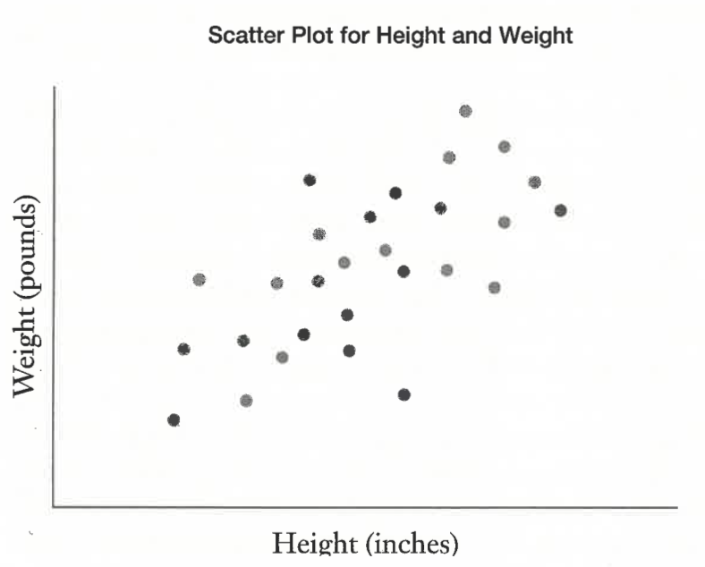
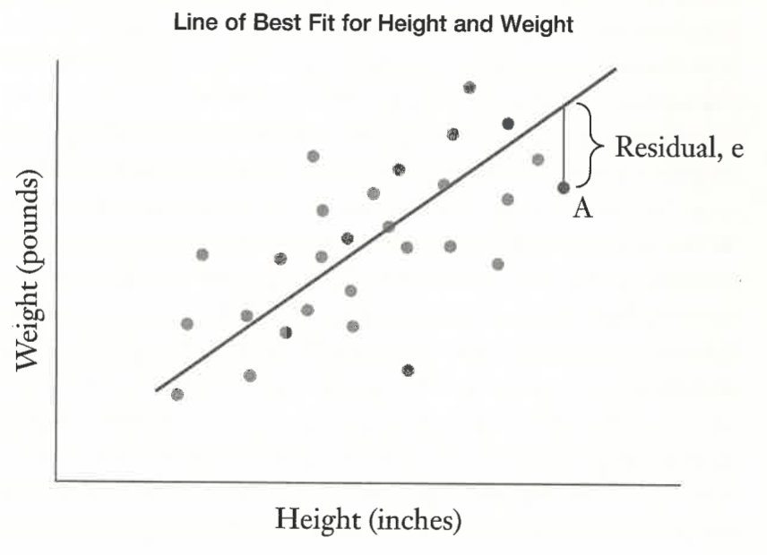
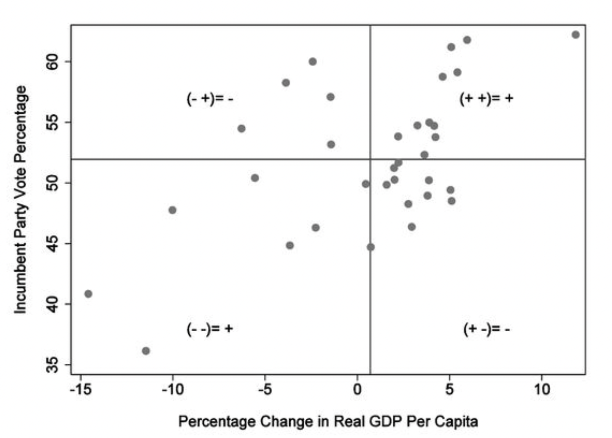
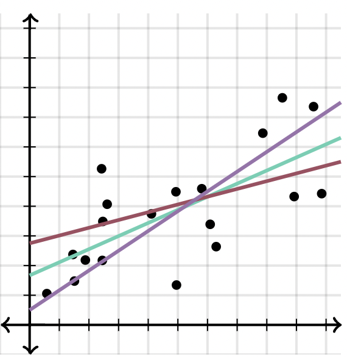
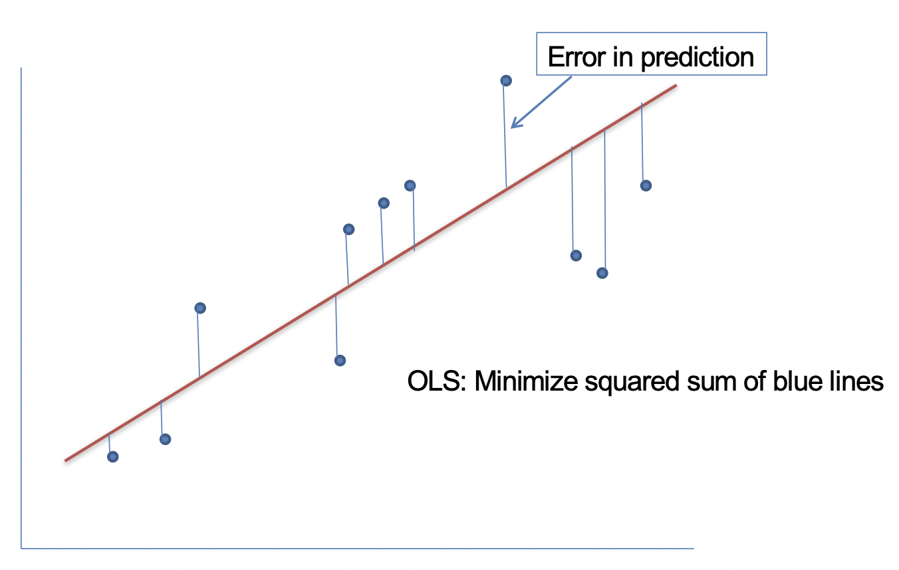
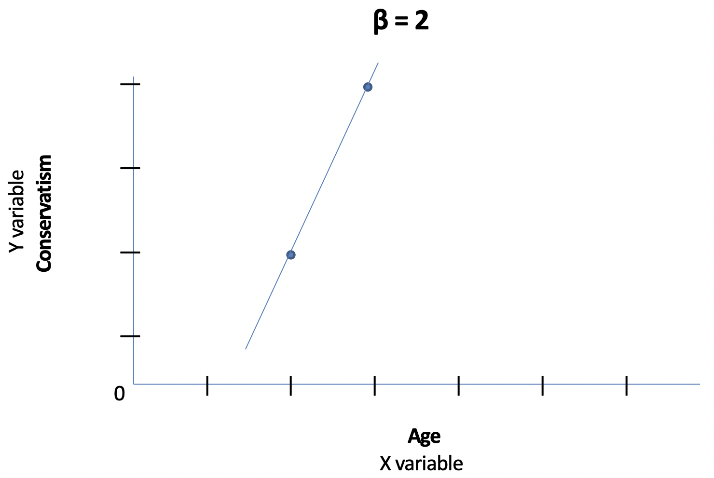
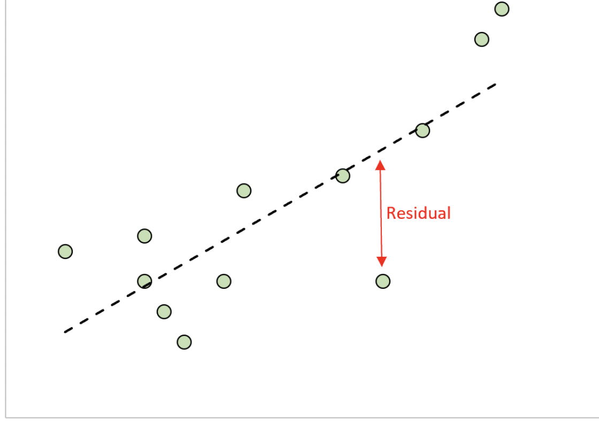
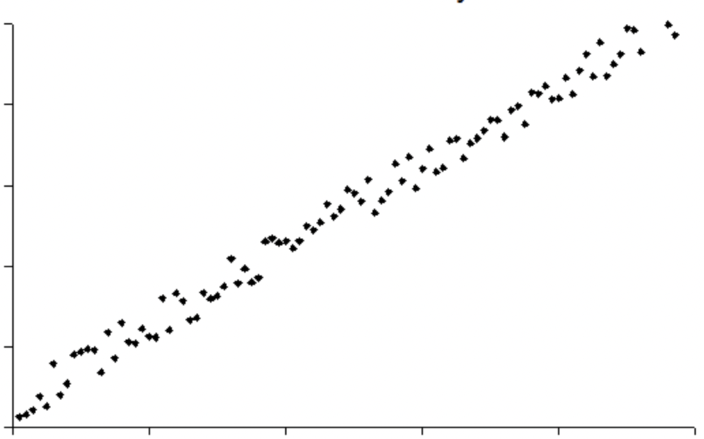
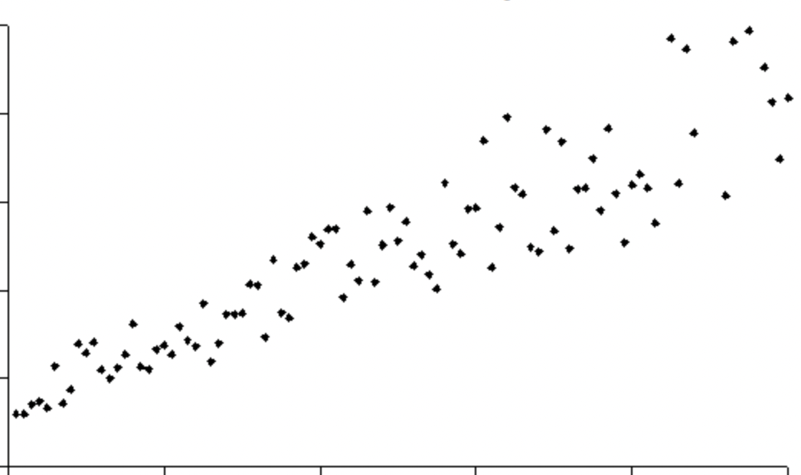

## Reading Prompt

As of right now: What do you understand / know about regression analysis? What does it get us that we didn't get from bivariate hypothesis tests?

---

## Announcements

- **Paid political internships:** Due this Friday (Oct 30)
- **Honors program:** Application due next Friday (Nov 6)
- **Dr. Dreier office hours this week:** Thurs 9-11 am
- **Karla office hours this week:** Thurs 12:30-2:30
- **Class plan:**
  - Data News: Abbey Gilmore, Lauren Eisenbeck
  - Wrap up bivariate hypothesis tests (*Fundamentals* Ch 9)
  - Bivariate regression analysis (*Fundamentals* Ch 10)

# Linear Regression

## Some other terms/concepts we have to know {style="font-size: 0.8em;"}

::: {.incremental}
- **Bivariate** (theory or model): involves just two variables (IV and DV).
- **Multivariate** (theory or model): most (all?) DVs in social science are caused by more than one factor.
  - Most of the time in social science, we are interested in a bivariate relationship (between the IV and DV) but we have to take other factors into account.
- **Deterministic relationship:** a given causal effect will occur with certainty.
  - Examples?
- **Probabilistic relationship:** some causal variable (X) will increase/decrease the *probability* of some outcome variable (Y) occurring.
  - Human interactions are not governed by "laws of nature" because humans have free will.
  - One case alone does not disprove our theory ("outlier").
  - Political science must be probabilistic in nature. There will always be exceptions.
- **Goal of political science:** identify probabilistic causal relationships.
:::

---

<!--
## Linear Regression

::: {.incremental}
- **Correlation:** Produces a measure of **association** that gauges the [direction and strength]{.hl} of a relationship between two continuous variables.
- **Regression:** Produces a statistic—the regression coefficient—that **estimates/predicts** the [size]{.hl} and the [effect]{.hl} of the [independent variable]{.hl} on the [dependent variable]{.hl}.
  - Structured to imply causality, but it is not necessarily the case.
:::
-->

## Linear Regression: Preview

:::{.incremental}
- Linear regression (ordinary least squares) give us **the best description of a linear relationship between two variables.**
:::

:::: {.columns}
::: {.column width="45%"}
{style="max-height: 40vh; width: auto;"}
:::

::: {.column width="55%"}
::: {.fragment}
{style="max-height: 40vh; width: auto;"}
:::
:::
::::

:::{.fragment}
Three valuable contributions: [sign, size, and significance]{.hl}
:::

::: {style="font-size: 0.55em; text-align: center;"}
Source: @wheelan2013naked [ch. 11]
:::

---

## Linear Regression

::: {.incremental}
- **Prediction**
- 1\. Using a set of collected data (sample), we can calculate if/how correlated variables are with one another
- 2\. Then we use that correlation and **the knowledge of a given X** to [predict the value of Y.]{.hl}
- ***Note: We must know a value of X to predict Y***
  - Strictly speaking, linear regression can only be used with *continuous dependent variables (Y).*
:::

---

## **Bivariate** Linear Regression

::: {.fragment fragment-index=1}
- Line
:::

::: {.eq .fragment fragment-index=2}
$Y = b + mX$
:::

:::: {.defs}
::: {}
[Y = value of your DV]{.fragment fragment-index=3}
:::
::: {}
[m = slope of the line]{.fragment fragment-index=3}

[X = value of your IV]{.fragment fragment-index=4}

[b = y-intercept]{.fragment fragment-index=5}
:::
::::

::: {.fragment fragment-index=6}
*Represents a perfectly straight line, with all points fitting on the line*
:::

::: {.fragment fragment-index=7}
(**deterministic relationship**)
:::

---

## **Bivariate** Linear Regression

::: {.fragment fragment-index=1}
- Regression Line
:::

::: {.eq .fragment fragment-index=2}
$Y_i = \alpha + \beta X_i$
:::

:::: {.defs}
::: {}
[$Y_i$ = value of your DV]{.fragment fragment-index=3}

[$X_i$ = value of your IV]{.fragment fragment-index=3}
:::
::: {}
[$\beta$ = slope "parameter"]{.fragment fragment-index=3}

[$\alpha$ = y-intercept "parameter"]{.fragment fragment-index=4}
:::
::::

::: {.fragment fragment-index=5}
*STILL Represents a perfectly straight line…*
:::

---

## **Bivariate** Linear Regression

<div style="text-align: center;"></div>

::: {style="font-size: 0.55em; text-align: center;"}
Source: @kellstedt2022fundamentals
:::

---

## **Bivariate** Linear Regression

- Regression Line

::: {.eq}
$Y_i = \alpha + \beta X_i +$ [$u_i$]{.pcircle .fragment .circle-reveal fragment-index=2}
:::

:::: {.defs}
::: {}
$Y_i$ = value of your DV

$X_i$ = value of your IV
:::
::: {}
$\beta$ = slope "parameter"

$\alpha$ = y-intercept "parameter"

[$u_i$ = stochastic (random) component]{.hl2 .fragment fragment-index=3}
:::
::::

*STILL Represents a perfectly straight line…*

::: {.fragment fragment-index=1}
[But we don't expect all of our data points to fall on that line]{.hl2}
:::

---

## **Bivariate** Linear Regression

::: {.fragment fragment-index=1}
- Regression Line
:::

::: {.eq .fragment fragment-index=2}
$Y_i = \alpha + \beta X_i + u_i$
:::

:::: {.defs}
::: {}
[$Y_i$ = value of your DV]{.fragment fragment-index=3}

[$X_i$ = value of your IV]{.fragment fragment-index=3}
:::
::: {}
[$\beta$ = slope parameter]{.fragment fragment-index=3}

[$\alpha$ = y-intercept parameter]{.fragment fragment-index=4}

[$u_i$ = stochastic (random) component]{.fragment fragment-index=5}
:::
::::

::: {.fragment fragment-index=6}
[Systematic component (the "thing" that connects IV → DV)]{.gr1}: $\color{#0F7A4A}{\alpha + \beta X_i}$
:::

---

## **Bivariate** Linear Regression

- Regression Line

::: {.eq}
$Y_i = \color{#0F7A4A}{\alpha + \beta X_i} + \color{#9a2515}{u_i}$
:::

:::: {.defs}
::: {}
$Y_i$ = value of your DV

$X_i$ = value of your IV
:::
::: {}
$\beta$ = slope parameter

$\alpha$ = y-intercept parameter

[$u_i$ = stochastic (random) component]{.hl2}
:::
::::

[Systematic component (the "thing" that connects IV → DV)]{.gr1}: $\color{#0F7A4A}{\alpha + \beta X_i}$

[Stochastic component (the "randomness" of human nature)]{.hl2}: $\color{#9a2515}{u_i}$

---

## **Bivariate** Linear Regression

::: {.fragment fragment-index=1}
**Goal: Use sample data to make inferences about the unseen population**
:::

::: {.fragment fragment-index=2}
**Regression model:**
:::

::: {.eq .fragment fragment-index=3}
$Y_i = \alpha + \beta X_i + u_i$
:::

::: {.fragment fragment-index=4}
**Notation:**
:::

::: {.fragment fragment-index=5}
- Use "hats" ($\hat{\ }$) over terms in the regression model that are *estimates* of terms from the *unseen population's* regression model. [← [Best guess]{.hl2}]{.fragment fragment-index=6}
:::

::: {.eq .fragment fragment-index=7}
$Y_i = \hat{\alpha} + \hat{\beta} X_i + \hat{u}_i$
:::

---

## **Bivariate** Linear Regression {.tightmath style="font-size: 0.85em;"}

**Goal: Use sample data to make inferences about the unseen population**

**Regression model:**

::: {.eq}
$Y_i = \alpha + \beta X_i + u_i$
:::

**Notation:**

- Use "hats" ($\hat{\ }$) over terms in the regression model that are *estimates* of terms from the *unseen population's* regression model. ← [Best guess]{.hl2}

::: {.eq}
$Y_i = \color{#9a2515}{\hat{\alpha}} + \color{#9a2515}{\hat{\beta}} X_i + \color{#9a2515}{\hat{u}_i}$
:::

::: {style="text-align: center;"}
↑ [Parameter estimates]{.hl2}
:::

---

## **Bivariate** Linear Regression {.tightmath style="font-size: 0.85em;"}

**Goal: Use sample data to make inferences about the unseen population**

**Regression model:**

::: {.eq}
$Y_i = \alpha + \beta X_i + u_i$
:::

**Notation:**

- Use "hats" ($\hat{\ }$) over terms in the regression model that are *estimates* of terms from the *unseen population's* regression model. ← [Best guess]{.hl2}

::: {.eq}
$\color{#0F7A4A}{Y_i} = \color{#9a2515}{\hat{\alpha}} + \color{#9a2515}{\hat{\beta}} \color{#0F7A4A}{X_i} + \color{#9a2515}{\hat{u}_i}$
:::

::: {style="text-align: center;"}
↑ [Parameter estimates]{.hl2} &emsp;&emsp; ↑ [measured values in the sample data]{.gr1}
:::

---

## Bivariate Linear Regression: [LOGIC (intuition)]{.hl2} {style="font-size: 0.9em;"}

::: {.eq .fragment fragment-index=1}
$Y_i = \hat{\alpha} + \hat{\beta} X_i + \hat{u}_i$
:::

::: {.fragment fragment-index=2}
With our sample data, we know $X_i$ and we know $Y_i$.
:::

::: {.fragment fragment-index=3}
Now, we can use our line equation (based on our sample data) to calculate the [predicted or expected value of $Y_i$]{.pcircle .fragment .circle-reveal fragment-index=4} [→ $\hat{Y}_i$]{.fragment fragment-index=5}
:::

::: {.eq .fragment fragment-index=6}
$E(Y|X_i) = \hat{Y}_i = \hat{\alpha} + \hat{\beta} X_i$
:::

::: {.fragment fragment-index=7}
Then, we compare our expected value of Y ($\hat{Y}_i$) to our actual value of Y ($Y_i$)
:::

::: {.eq .fragment fragment-index=8}
$Y_i - \hat{Y}_i$
:::

---

## **Bivariate** Linear Regression: [LOGIC (intuition)]{.hl2} {style="font-size: 0.9em;"}

::: {.eq}
$Y_i = \hat{\alpha} + \hat{\beta} X_i + \hat{u}_i$
:::

With our sample data, we know $X_i$ and we know $Y_i$.

Now, we can use our line equation (based on our sample data) to calculate the [predicted or expected value of $Y_i$]{.pcircle} → $\hat{Y}_i$

::: {.eq}
$E(Y|X_i) = \hat{Y}_i = \hat{\alpha} + \hat{\beta} X_i$
:::

Then, we compare our expected value of Y ($\hat{Y}_i$) to our actual value of Y ($Y_i$)

::: {.eq}
$Y_i - \hat{Y}_i =$ [$\hat{u}_i$]{.pcircle .fragment .circle-reveal fragment-index=1} [&ensp;← Residual (leftover) / Sample error term]{.hl2 .fragment fragment-index=1 style="font-size: 0.7em;"}
:::

---

## **Bivariate** Linear Regression

:::: {.columns}
::: {.column width="45%"}
::: {.fragment}
**Regression Line:** The line that minimizes the distance between the line itself and each data point.
:::

::: {.fragment}
*Reflects our best guess as to what score on the Y variable would be produced by a given score on the X variable.*
:::
:::

::: {.column width="55%"}
<div style="text-align: center;"></div>
:::
::::

---

## {#ols-video-1}

<div id="ols-yt-1" style="height: 72vh; aspect-ratio: 9 / 16; margin: 0 auto;"></div>

```{=html}
<script>
(function () {
  var mount = document.getElementById("ols-yt-1");
  if (!mount || mount.dataset.loaded) return;
  mount.dataset.loaded = "1";
  var frame = document.createElement("iframe");
  frame.width = "100%";
  frame.height = "100%";
  frame.title = "Ordinary least squares (YouTube Short)";
  frame.frameBorder = "0";
  frame.allow = "encrypted-media; picture-in-picture; fullscreen";
  frame.allowFullscreen = true;
  frame.src = "https://www.youtube.com/embed/" + "fHzF0804yG8" + "?rel=0";
  mount.appendChild(frame);
})();
</script>
```

::: {style="text-align: center; font-size: 0.5em;"}
<https://www.youtube.com/shorts/fHzF0804yG8>
:::

---

## **Bivariate** Linear Regression {style="font-size: 0.9em;"}

:::: {.columns}
::: {.column width="38%"}
**Regression Line:** The line that minimizes the distance between the line itself and each data point.

*Reflects our best guess as to what score on the Y variable would be produced by a given score on the X variable.*
:::

::: {.column width="62%"}
Add up all of the differences ($\hat{u}_i$) between $Y_i$ and $\hat{Y}_i$

($\hat{u}_i = Y_i - \hat{Y}_i$)

. . .

Convert them all to positive numbers (abs or sq)

. . .

::: {.eq}
$\sum_{i=1}^{n} \hat{u}_i^2$
:::

. . .

Draw the line that has the smallest possible result

. . .

→ **ordinary least-squares (OLS)**
:::
::::

---

## **Bivariate** Linear Regression

:::: {.columns}
::: {.column width="38%"}
**Regression Line:** The line that minimizes the distance between the line itself and each data point.

**Ordinary least-squares (OLS) regression**
:::

::: {.column width="62%"}
::: {.fragment fragment-index=1 style="position: relative;"}
<div style="text-align: center;"></div>

[residual]{.hl2 .pcircle .fragment fragment-index=2 style="position: absolute; top: 2%; left: 4%;"}
:::
:::
::::

---

## **Bivariate** Linear Regression

:::: {.columns}
::: {.column width="38%"}
**Regression Line:** The line that minimizes the distance between the line itself and each data point.

Calculate OLS regression model's parameters ($\hat{\beta}$ and $\hat{\alpha}$) using the known Xs and known Ys in the sample dataset.
:::

::: {.column width="62%"}
::: {style="position: relative;"}
<div style="text-align: center;"></div>

[residual]{.hl2 .pcircle style="position: absolute; top: 2%; left: 4%;"}
:::
:::
::::

---

## **Bivariate** Linear Regression

::: {.fragment}
**OLS equations:**
:::

::: {.eq .fragment}
$\displaystyle \hat{\beta} = \frac{\sum_{i=1}^{n}(X_i - \bar{X})(Y_i - \bar{Y})}{\sum_{i=1}^{n}(X_i - \bar{X})^2}$
:::

::: {.eq .fragment}
$\hat{\alpha} = \bar{Y} - \hat{\beta}\bar{X}$
:::

---

## **Bivariate** Linear Regression

**OLS equations:**

::: {.eq}
$\displaystyle \hat{\beta} = \frac{\color{#0F7A4A}{\sum_{i=1}^{n}(X_i - \bar{X})(Y_i - \bar{Y})}}{\sum_{i=1}^{n}(X_i - \bar{X})^2}$
:::

::: {.eq}
$\hat{\alpha} = \bar{Y} - \hat{\beta}\bar{X}$
:::

- [Same as numerator for calculating *covariance* between X and Y]{style="color: #0F7A4A;"}

---

## **Bivariate** Linear Regression

**OLS equations:**

::: {.eq}
$\displaystyle \hat{\beta} = \frac{\sum_{i=1}^{n}(X_i - \bar{X})(Y_i - \bar{Y})}{\color{#9a2515}{\sum_{i=1}^{n}(X_i - \bar{X})^2}}$
:::

::: {.eq}
$\hat{\alpha} = \bar{Y} - \hat{\beta}\bar{X}$
:::

- Same as numerator for calculating *covariance* between X and Y
- [Denominator based on X → using values of the IV to calculate parameters]{style="color: #9a2515;"}

---

## **Bivariate** Linear Regression {style="font-size: 0.9em;"}

**OLS equations:**

::: {.eq}
$\displaystyle \hat{\beta} = \frac{\sum_{i=1}^{n}(X_i - \bar{X})(Y_i - \bar{Y})}{\sum_{i=1}^{n}(X_i - \bar{X})^2}$
:::

::: {.eq}
$\hat{\alpha} = \bar{Y} - \hat{\beta}\bar{X}$
:::

- Same as numerator for calculating *covariance* between X and Y
- Denominator based on X → using values of the IV to calculate parameters
- The regression line (that is produced by the parameter estimates $\hat{\beta}$ and $\hat{\alpha}$) goes through the sample's mean values for X and Y

---

## Linear Regression {style="font-size: 0.9em;"}

:::: {.columns}
::: {.column width="52%"}
::: {.incremental}
- **Interpreting OLS**
- Produces a regression coefficient ($\hat{\beta}$) that reveals the estimated nature of the relationship between X and Y
- $\hat{\beta}$ Reports the amount of change in the dependent variable (Y) we observe for a one-unit change in the independent variable (X)
- A one-unit change in our IV is *expected* to lead to a $\hat{\beta}$ change in our DV.
:::
:::

::: {.column width="48%"}
::: {.fragment}
<div style="text-align: center;"></div>
:::
:::
::::

---

## Linear Regression {style="font-size: 0.9em;"}

:::: {.columns}
::: {.column width="52%"}
- **Interpreting OLS**
- Produces a regression coefficient ($\beta$) that reveals the estimated nature of the relationship between X and Y
- $\beta$ Reports the amount of change in the dependent variable (Y) we observe for a one-unit change in the independent variable (X)
- A one-unit [increase in age]{.hl} is *expected* to lead to a [2-unit increase in conservativism]{.hl}.
:::

::: {.column width="48%"}
<div style="text-align: center;"></div>
:::
::::

# Regression, continued

## Recall…

. . .

**OLS linear regression:** Find the line of expected values (for X, Y) that minimizes the (squared) distance between the observed Y and predicted Y.

---

## Recall…

<div style="text-align: center;"></div>

. . .

**OLS linear regression:** Find the line of expected values (for X, Y) that minimizes the (squared) distance between the observed Y and predicted Y.

---

## Recall…

::: {.incremental}
- **OLS linear regression:** Find the line of expected values (for X, Y) that minimizes the (squared) distance between the observed Y and predicted Y.
- A **bivariate regression line** contains [two measured values from the sample data]{.gr1}, [two parameters that we estimate about the underlying population]{.hl2}, and the "[error term]{.hl}" that represents the distance between the observed and estimated values of Y.
- $\color{#0F7A4A}{Y_i} = \color{#9a2515}{\hat{\alpha}} + \color{#9a2515}{\hat{\beta}} \color{#0F7A4A}{X_i} + \color{#107895}{u_i}$
:::

---

## Recall…

::: {.incremental}
- **OLS linear regression:** Find the line of expected values (for X, Y) that minimizes the (squared) distance between the observed Y and predicted Y.
- A **bivariate regression line** contains two measured values from the sample data, two parameters that we estimate about the underlying population, and the "error term" that represents the distance between the observed and estimated values of Y.
- The $\boldsymbol{\beta}$ **(beta) coefficient** (aka beta parameter) reports the amount of change in the dependent variable (Y) we observe for a one-unit change in the independent variable (X).
:::

---

## Recall… {style="font-size: 0.9em;"}

::: {.incremental}
- **OLS linear regression:** Find the line of expected values (for X, Y) that minimizes the (squared) distance between the observed Y and predicted Y.
- A **bivariate regression line** contains two measured values from the sample data, two parameters that we estimate about the underlying population, and the "error term" that represents the distance between the observed and estimated values of Y.
- The $\boldsymbol{\beta}$ **(beta) coefficient** (aka beta parameter) reports the amount of change in the dependent variable (Y) we observe for a one-unit change in the independent variable (X).
- Because social science is **probabilistic**, models will always have uncertainty.
:::

---

## Code from lecture

**Example**

:::: {.columns}
::: {.column width="50%"}
IV: political ideology (1: very liberal; 7: very conservative)
:::
::: {.column width="50%"}
DV: importance of climate change (1: not important; 5: extremely important)
:::
::::

```{.r}
model.biv <- lm(impt_climate ~ ideology, data = anes_data)
summary(model.biv)
stargazer(model.biv, type = "text",
          dep.var.labels = "Importance of climate change")
```

---

## {#ols-video-2}

<div id="ols-yt-2" style="height: 72vh; aspect-ratio: 9 / 16; margin: 0 auto;"></div>

```{=html}
<script>
(function () {
  var mount = document.getElementById("ols-yt-2");
  if (!mount || mount.dataset.loaded) return;
  mount.dataset.loaded = "1";
  var frame = document.createElement("iframe");
  frame.width = "100%";
  frame.height = "100%";
  frame.title = "Ordinary least squares (YouTube Short)";
  frame.frameBorder = "0";
  frame.allow = "encrypted-media; picture-in-picture; fullscreen";
  frame.allowFullscreen = true;
  frame.src = "https://www.youtube.com/embed/" + "fHzF0804yG8" + "?rel=0";
  mount.appendChild(frame);
})();
</script>
```

::: {style="text-align: center; font-size: 0.5em;"}
<https://www.youtube.com/shorts/fHzF0804yG8>
:::

# Goodness of Fit

Measures the goodness of fit between the regression line and the actual sample data

## Goodness of fit

::: {.incremental}
- **R-Square Statistic (R^2^)**
- Indicates the proportion of the variation in the dependent variable that is accounted for by the model.
- Overall, how good a job does the independent variable do in predicting the dependent variable?
- Range: {0, 1}
:::

---

## Goodness of fit

:::: {.columns}
::: {.column width="45%"}
<svg viewBox="20 20 58 54" style="width:100%; max-height:48vh;" xmlns="http://www.w3.org/2000/svg" font-family="Source Sans Pro, Helvetica, sans-serif"><circle cx="41" cy="40.5" r="17" fill="#107895" fill-opacity="0.2" stroke="#107895" stroke-width="0.4"/><circle cx="56" cy="48.5" r="17" fill="#9a2515" fill-opacity="0.2" stroke="#9a2515" stroke-width="0.4"/><text x="32" y="41.5" font-size="4.2" text-anchor="middle" fill="#1a1a1a" font-style="italic">a</text><text x="49" y="46.5" font-size="4.2" text-anchor="middle" fill="#1a1a1a" font-style="italic">b</text><text x="65" y="49.5" font-size="4.2" text-anchor="middle" fill="#1a1a1a" font-style="italic">c</text><text x="39" y="61" font-size="4.2" text-anchor="middle" fill="#1a1a1a">Y</text><text x="58" y="69.5" font-size="4.2" text-anchor="middle" fill="#9a2515">X</text></svg>
:::

::: {.column width="55%"}
::: {.fragment}
**R-Square Statistic (R^2^)**
:::

::: {.fragment}
**a + b = total variation in Y (DV)**
:::

::: {.fragment}
**b + c = total variation in X (IV)**
:::

::: {.fragment}
**a = variation in Y (DV) not related to (explained by) variation in X (IV)**
:::

::: {.fragment}
**b = covariation between X and Y**
:::
:::
::::

---

## Goodness of fit

:::: {.columns}
::: {.column width="45%"}
<svg viewBox="20 20 58 54" style="width:100%; max-height:48vh;" xmlns="http://www.w3.org/2000/svg" font-family="Source Sans Pro, Helvetica, sans-serif"><circle cx="41" cy="40.5" r="17" fill="#107895" fill-opacity="0.2" stroke="#107895" stroke-width="0.4"/><circle cx="56" cy="48.5" r="17" fill="#9a2515" fill-opacity="0.2" stroke="#9a2515" stroke-width="0.4"/><text x="32" y="41.5" font-size="4.2" text-anchor="middle" fill="#1a1a1a" font-style="italic">a</text><text x="49" y="46.5" font-size="4.2" text-anchor="middle" fill="#1a1a1a" font-style="italic">b</text><text x="65" y="49.5" font-size="4.2" text-anchor="middle" fill="#1a1a1a" font-style="italic">c</text><text x="39" y="61" font-size="4.2" text-anchor="middle" fill="#1a1a1a">Y</text><text x="58" y="69.5" font-size="4.2" text-anchor="middle" fill="#9a2515">X</text></svg>
:::

::: {.column width="55%"}
**R-Square Statistic (R^2^)**

**a + b = total variation in Y (DV)**

**b + c = total variation in X (IV)**

**a = residual / stochastic (random) variation in Y**

**b = systematic component**
:::
::::

---

## Goodness of fit

**R-Square Statistic (R^2^)**

<svg viewBox="13 17 120 57" style="width:100%; max-height:48vh;" xmlns="http://www.w3.org/2000/svg" font-family="Source Sans Pro, Helvetica, sans-serif"><circle cx="34" cy="37.5" r="17" fill="#107895" fill-opacity="0.2" stroke="#107895" stroke-width="0.4"/><circle cx="56" cy="48.5" r="17" fill="#9a2515" fill-opacity="0.2" stroke="#9a2515" stroke-width="0.4"/><circle cx="102" cy="44.5" r="17" fill="#107895" fill-opacity="0.2" stroke="#107895" stroke-width="0.4"/><circle cx="111" cy="49.5" r="17" fill="#9a2515" fill-opacity="0.2" stroke="#9a2515" stroke-width="0.4"/><text x="25" y="38.5" font-size="4.2" text-anchor="middle" fill="#1a1a1a" font-style="italic">a</text><text x="46" y="44.5" font-size="4.2" text-anchor="middle" fill="#1a1a1a" font-style="italic">b</text><text x="65" y="49.5" font-size="4.2" text-anchor="middle" fill="#1a1a1a" font-style="italic">c</text><text x="32" y="58" font-size="4.2" text-anchor="middle" fill="#1a1a1a">Y</text><text x="58" y="69.5" font-size="4.2" text-anchor="middle" fill="#9a2515">X</text><text x="93" y="45.5" font-size="4.2" text-anchor="middle" fill="#1a1a1a" font-style="italic">a</text><text x="106.5" y="48.5" font-size="4.2" text-anchor="middle" fill="#1a1a1a" font-style="italic">b</text><text x="120" y="50.5" font-size="4.2" text-anchor="middle" fill="#1a1a1a" font-style="italic">c</text><text x="95" y="64" font-size="4.2" text-anchor="middle" fill="#1a1a1a">Y</text><text x="115" y="70.5" font-size="4.2" text-anchor="middle" fill="#9a2515">X</text></svg>

---

## Goodness of fit {style="font-size: 0.85em;"}

**R-Square Statistic (R^2^)**

::: {.incremental}
- If R^2^ = 0.324, it means that our OLS regression model accounts for 32% of the variation in the dependent variable.
- Is this good?
- If this R^2^ is about our economy/incumbent vote example:
- *"We are able to…explain just over 32 percent of the variation in incumbent vote from 1876-2016 with just one measure of the economy. When we start to think of all of the different campaign strategies, personalities, scandals, wars, and everything else that is not in this simple model, this level of accuracy is rather impressive. In fact, we would suggest that this tells us something pretty remarkable about the politics of the United States – the economy is massively important"* [@kellstedt2018fundamentals, p. 199].
:::

---

## Uncertainty {style="font-size: 0.9em;"}

::: {.incremental}
- An important aspect of regression models is our **degree of uncertainty** about **individual estimates of population parameter values** from the **sample regression model**.
- General ideas:
  - Y: The farther the points representing our data (sample) are from the regression line, the less confidence we will have in the value of the slope
  - X: The more variation we have in X, the more precisely we will be able to estimate the relationship between X and Y.
  - Larger sample sizes will, **other things being equal**, produce smaller standard errors of our estimated regression coefficients.
:::

---

## Linear Regression

::: {.fragment}
For now, the most important difference between **bivariate hypothesis testing** and **bivariate linear regression** (here, OLS) has to do [with how we interpret the relationship between X and Y.]{.hl}
:::

::: {.fragment}
Sneak peek to next week (Ch 11): OLS linear regression makes it easy to **control for other confounding (Z) variables!**
:::

<table class="arrows">
<tr class="fragment"><td>X ⟷ Y</td><td>(bivariate hypothesis testing)</td></tr>
<tr class="fragment"><td>X → Y</td><td>(bivariate regression)</td></tr>
<tr class="fragment"><td>X<sub>1</sub> + X<sub>2</sub> + X<sub>3</sub> + X<sub>4</sub> → Y</td><td>(multiple regression)</td></tr>
</table>

---

## For Tuesday:

[*Fundamentals*, Ch 11, "Multiple Regression," 201–232](https://skdreier.github.io/POLS2140/)

(See the full schedule on the syllabus.)

---

## TL;DR {style="font-size: 0.9em;"}

- **Bivariate regression** models Y as a **systematic component** plus a **stochastic component**: $Y_i = \alpha + \beta X_i + u_i$. Hats ($\hat{\alpha}, \hat{\beta}, \hat{u}_i$) mark our *sample estimates* of the unseen population's parameters.
- **OLS** picks the line that minimizes the sum of squared residuals ($\hat{u}_i = Y_i - \hat{Y}_i$); that line always passes through the sample means of X and Y.
- **Interpreting $\hat{\beta}$:** a one-unit increase in X is *expected* to produce a $\hat{\beta}$-unit change in Y (e.g., $\beta = 2$: one more year of age → 2 units more conservative).
- **R^2^** is the share of the variation in Y the model accounts for (0 to 1); our estimates are *less* uncertain with a tighter fit, more variation in X, and larger samples.
- Unlike bivariate hypothesis tests (X ⟷ Y), regression interprets X → Y — and next week it lets us **control for confounding Z variables**.

---

## References {.smaller}

::: {#refs}
:::

# Appendix: slides not used in lecture

## Goodness of fit

**Root Mean-Squared Error**

- Measure of the average accuracy of the model – the average distance between the data points and the regression line

::: {.eq}
$\displaystyle \sqrt{\frac{\sum_{i=1}^{n}\hat{u}_i^2}{n}}$
:::

---

## Goodness of fit

:::: {.columns}
::: {.column width="50%"}
**Root Mean-Squared Error**

- Measure of the average accuracy of the model – the average distance between the data points and the regression line

::: {.eq}
$\displaystyle \sqrt{\frac{\sum_{i=1}^{n}\hat{u}_i^2}{n}}$
:::
:::

::: {.column width="50%"}
<div style="text-align: center;"></div>
:::
::::

---

## Goodness of fit

**Root Mean-Squared Error**

- Measure of the average accuracy of the model – the average distance between the data points and the regression line

::: {.eq}
$\displaystyle \sqrt{\frac{\sum_{i=1}^{n}\hat{u}_i^2}{n}}$
:::

---

## Goodness of fit

**Root Mean-Squared Error**

- Measure of the average accuracy of the model – the average distance between the data points and the regression line

::: {.eq}
*root MSE* = $\displaystyle \sqrt{\frac{\sum_{i=1}^{n}\hat{u}_i^2}{n}}$
:::

::: {.incremental}
- Ex: If root MSE=4: On average, our model is off by 4 in predicting the DV
- This measure is always expressed in terms of how the **DV is measured**.
:::

# Assumptions (linear regression)

## Mathematical requirements

::: {.incremental}
- **1. X must vary.**
  - If not, the only reasonable line is a straight vertical line.
  - This doesn't help us explain Y, because any value of Y would be as good as any other.
- **2. $\boldsymbol{n > k}$**
  - The number of cases (n) must exceed the number of parameters to be estimated (k)
  - For a two-variable regression model with two parameters ($\alpha$ and $\beta$), what is the minimum number of cases we must have?
  - **3!**
:::

---

## Assumptions {style="font-size: 0.9em;"}

::: {.incremental}
- We are trying to simplify complex realities.
- We must make unrealistic assumptions about the world (underlying population)
- ***Solution: Never lose sight of these unrealistic assumptions***
- How you deal with these assumptions—and whether or not they are appropriate to make—depends on the nature of your data and your analysis. Some more complex models allow you to "relax" some of these assumptions. But for now, we should just think through what assumptions we are making and where we expect we might be violating these assumptions.
:::

---

## Assumptions {style="font-size: 0.85em;"}

::: {.incremental}
- **Assumptions about the [population's stochastic component (*u~i~*)]{.hl2}**
- ANY TIME you estimate a regression model, you are making several assumptions about the unseen population model.
- We assume that:
- **1. *u~i~* is normally distributed:**
  - the population stochastic (random) component (*u~i~*) are normally distributed with a mean value of 0.
  - Central limit theorem!
  - Allows us to make probabilistic inferences about the population from the sample
:::

---

## Assumptions {style="font-size: 0.78em;"}

**Assumptions about the [population's stochastic component (*u~i~*)]{.hl2}**

ANY TIME you estimate a regression model, you are making several assumptions about the unseen population model.

We assume that:

::: {.fragment}
**2. E(*u~i~*) = 0 → No Bias**

- *u~i~* is supposed to be random. If the expected value **E(*u~i~*)** $\neq$ 0, there must be some nonrandom component to this term.
- Some individual cases will fall above the regression line (*u~i~* $>$ 0) and some will fall below the regression line (*u~i~* $<$ 0), but the mean should = 0
- Assumption: There is no other confounding variable (Z) that is also shaping the relationship between IV and DV.
- Ex: During times of war, voters prefer the incumbent president
:::

---

## Assumptions {style="font-size: 0.85em;"}

**Assumptions about the [population's stochastic component (*u~i~*)]{.hl2}**

ANY TIME you estimate a regression model, you are making several assumptions about the unseen population model.

We assume that:

::: {.fragment}
**3. *u~i~* is homoscedastic**

- The variance for every case in the population is assumed to be the same ("uniform error variance")
- If we do not have uniform error variance, the model fits some of the cases in the population better than others.
- Ex: If some elections (e.g., those held after televised debates) are harder/easier to predict than others, we cannot make this assumption.
:::

---

## Assumptions

**Assumptions about the [population's stochastic component (*u~i~*)]{.hl2}**

:::: {.columns}
::: {.column width="50%"}
::: {style="text-align: center;"}
[Homoscedastic residuals]{style="color: #9a2515;"}
:::
<div style="text-align: center;"></div>
:::

::: {.column width="50%"}
::: {style="text-align: center;"}
[Heteroscedastic residuals]{style="color: #9a2515;"}
:::
<div style="text-align: center;"></div>
:::
::::

---

## Assumptions

**Assumptions about the [population's stochastic component (*u~i~*)]{.hl2}**

:::: {.columns}
::: {.column width="50%"}
::: {style="text-align: center;"}
[Homoscedastic residuals]{.hl2}
:::
<div style="text-align: center;"></div>
:::

::: {.column width="50%"}
::: {style="text-align: center;"}
[Heteroscedastic residuals]{style="color: #9a2515;"}
:::
<div style="text-align: center;"></div>
:::
::::

---

## Assumptions {style="font-size: 0.85em;"}

**Assumptions about the [population's stochastic component (*u~i~*)]{.hl2}**

ANY TIME you estimate a regression model, you are making several assumptions about the unseen population model.

We assume that:

::: {.fragment}
**4. No autocorrelation**

- When the stochastic terms for any two or more cases (observations) are systematically related to each other.
- Particularly an issue with ***time series data***
:::

::: {.fragment style="text-align: right;"}
[World Bank: restrict to 1 year]{.hl2}
:::

---

## Assumptions {style="font-size: 0.85em;"}

**Assumptions about the [population's stochastic component (*u~i~*)]{.hl2}**

ANY TIME you estimate a regression model, you are making several assumptions about the unseen population model.

We assume that:

::: {.fragment}
**5. X values are measured without error**

- If so, then any variability from our regression line is due to the stochastic component *u~i~*, not to measurement problems in X.
- How realistic is it to assume that we have exactly correct measures of Xs?
:::

---

## Assumptions {style="font-size: 0.85em;"}

**Assumptions about the model specification**

ANY TIME you estimate a regression model, you are assuming that you have ***the correct model specification.***

We assume that:

**1. No confounding variables**

- In X → Y, we assume:
  - that X causes Y
  - there is not some other variable Z that also causes Y

---

## Assumptions {style="font-size: 0.85em;"}

**Assumptions about the model specification**

ANY TIME you estimate a regression model, you are assuming that you have ***the correct model specification.***

We assume that:

**2. The relationship between X and Y are the same across all values of X**

- Linear relationship
- Our population parameter $\beta$ for the relationship between X and Y does not vary
- The impact of a one-unit increase in change in X is always the same.
