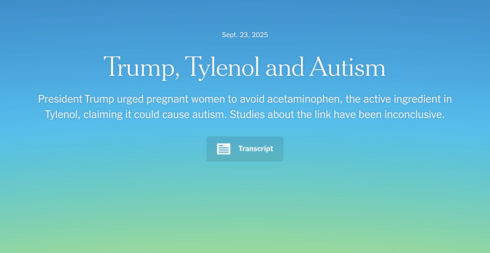
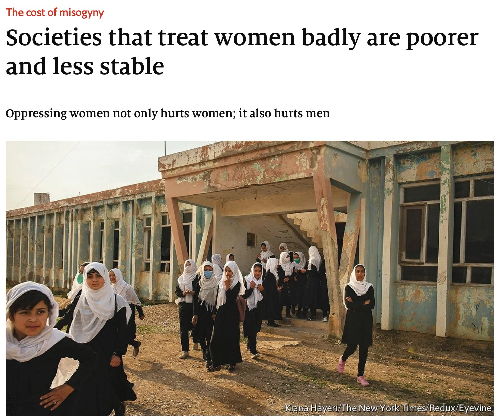
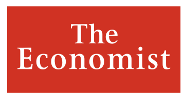

```{r}
#| label: setup
#| include: false
# Pull named sections ("## ---- name ----") from the class R script so the
# slides run the real analysis. Edit the analysis there, not here.
library(tidyverse)
knitr::read_chunk("../survey_experiment/Example Survey Experiment Analysis.R")
# The script's own read_csv() depends on its setwd(), so load the data here.
df <- read_csv("../survey_experiment/survey_experiment_output_w_class.csv",
               show_col_types = FALSE)
```

```{r clean}
#| include: false
```

```{r hegseth-prep}
#| include: false
```

```{r hegseth-factor}
#| include: false
```

## Quick survey:

[https://qualtricsxm6jcjtf566.qualtrics.com/jfe/form/SV_emaqAf56FKPl1rg](https://qualtricsxm6jcjtf566.qualtrics.com/jfe/form/SV_emaqAf56FKPl1rg)

<div style="text-align: center; margin: 0;"></div>

(Also available on Canvas Modules --> Course Exercises)

## Reading Prompt

What is one key difference between an experimental research design and an observational research design? Which of the two approaches have **you** used in your analysis for this course?

---

## Announcements

- Dr. Dreier's Office Hours: Today (2:30-4:30)
- Karla's Office Hours: Thurs (12:30-2:30)
- Optional class next Tuesday: Regression Interpretation

---

## Limits to multiple-variable regression {style="font-size: 0.78em;"}

. . .

[What *can't* multiple regression tell us?]{.hl}

. . .

**Last week's model:** Controlling for gender, age, and education, a one-point move toward the conservative end of the ideology scale is associated with a [7.61-point colder rating]{.hl} of gay men and lesbian women.

. . .

Does ideology (conservativism) [cause]{.hl} those colder feelings? [OLS can't settle this definitively:]{.fragment}

::: {.incremental}
- **Unmeasured confounders (Z):** We can only control for variables we *measure* and *include*. [Religiosity, where someone grew up, being queer or knowing a gay person, and any number of other factors could shape both ideology and attitudes. And any Z we leave out biases $\hat{\beta}$ (omitted variable bias).]{.fragment}
- **Reverse causality:** Maybe attitudes toward gay people push people toward a conservative (or liberal) identity, not the other way around. The regression line looks the same either way.
- **Self-selection:** Nobody is *assigned* an ideology. People who end up conservative differ from liberals in countless ways we can't see.
:::

. . .

[In short: an OLS coefficient is an association, *holding the measured controls constant* — not proof that X causes Y.]{.hl2}

<!--
---

## What if we could set the value of X ourselves? {style="font-size: 0.9em;"}

::: {.incremental}
- Imagine flipping a coin to decide who receives the "treatment" (X = 1) and who doesn't (X = 0). (Random assignment)
- Then religiosity, upbringing, income, personal relationships, sexual orientation — every Z, *even the ones we never thought to measure* — would be balanced across the two groups, on average.
- The arrow could only run one way: we set X **before** we measured Y.
- Any difference in Y between the groups would have to come from X.
- That is the logic of an [experiment]{.hl}.
:::
-->

# Experimental Research

<!--
## How do we isolate one cause?

Most phenomena in the political world have multiple causes at once, but our theories typically deal with one cause at a time.

. . .

How, then, do we isolate the effect that just one IV has on our DV?

. . .

Three ways to do this:

::: {.incremental}
- Experiments [are the gold standard for scientific research]{.fragment .hl}
- Observational studies with statistical controls
- Qualitative process tracing
:::
--->


## Experimental research design {style="font-size: 0.9em;"}

An [experiment]{.hl} is a research design in which the researcher both controls and randomly assigns values of the independent variable to the participants of the experiment. The researcher then compares the dependent variable values based on the different values of the independent variable.

---

## Experimental research design {style="font-size: 0.9em;"}

An [experiment]{.hl} is a research design in which the researcher both [controls]{.hl2} and randomly assigns values of the independent variable to the participants of the experiment. The researcher then compares the dependent variable values based on the different values of the independent variable.

. . .

**[Controlling]{.hl2} the values of the independent variable:**

. . .

For now, think of the IV as having only two values: 0, 1

::: {.incremental}
- **Treatment group:** The group that gets the "treatment" (IV value = 1)
- **Control group:** The group that does not get the treatment (IV value = 0)
:::

---

## {#pfizer-groups}

::::: {#pfizer-groups-wrap style="position: relative;"}
:::: {.columns}
::: {.column width="22%"}


::: {.fragment fragment-index="2" style="margin-top: 1.2em; font-size: 0.75em; line-height: 1.6;"}
[Control (IV = 0)]{#ctrl-lab .hl2}

[Treatment (IV = 1)]{#treat-lab .hl}
:::
:::

::: {.column width="78%"}
<div class="imgwrap" id="pfizer-img-wrap"><div class="oval fragment" data-fragment-index="1" style="left: 1.9%; top: 8.9%; width: 98.1%; height: 35.7%;"></div></div>
:::
::::

<div class="fragment" data-fragment-index="3" style="position: absolute; left: 0; top: 0; width: 100%; height: 100%; pointer-events: none;"><svg viewBox="0 0 945 373" style="width: 100%; height: 100%; overflow: visible;"><defs><marker id="arr-ctrl" markerWidth="10" markerHeight="8" refX="9" refY="4" orient="auto" markerUnits="userSpaceOnUse"><path d="M0,0 L10,4 L0,8 z" fill="#9a2515"/></marker></defs><line x1="150" y1="268" x2="401" y2="99" stroke="#9a2515" stroke-width="2.5" marker-end="url(#arr-ctrl)"/></svg></div>
<div class="fragment" data-fragment-index="4" style="position: absolute; left: 0; top: 0; width: 100%; height: 100%; pointer-events: none;"><svg viewBox="0 0 945 373" style="width: 100%; height: 100%; overflow: visible;"><defs><marker id="arr-treat" markerWidth="10" markerHeight="8" refX="9" refY="4" orient="auto" markerUnits="userSpaceOnUse"><path d="M0,0 L10,4 L0,8 z" fill="#107895"/></marker></defs><line x1="180" y1="323" x2="535" y2="124" stroke="#107895" stroke-width="2.5" marker-end="url(#arr-treat)"/></svg></div>
:::::

::: {.src}
Source: @duke2021pfizer
:::


---

## Experimental research design {style="font-size: 0.9em;"}

An [experiment]{.hl} is a research design in which the researcher both **controls** and randomly assigns values of the independent variable to the participants of the experiment. The researcher then [compares]{.hl2} the dependent variable values based on the different values of the independent variable.

. . .

[Comparing]{.hl2} the outcomes allows the researcher to conclude how her treatment (her independent variable, for which she controlled the values) causes different outcomes for her dependent variable.

---

## {#pfizer-compare}

:::: {.columns}
::: {.column width="22%"}

:::

::: {.column width="78%"}
<div class="imgwrap"><div class="oval fragment" data-fragment-index="2" style="left: -2.8%; top: 62.5%; width: 105.7%; height: 42.9%;"></div></div>

::: {.fragment fragment-index="1" style="margin-top: 0.9em; font-size: 0.8em;"}
[Compare values of the DV]{.hl2}
:::
:::
::::

::: {.src}
Source: @duke2021pfizer
:::


---

## Experimental research design {style="font-size: 0.9em;"}

An [experiment]{.hl} is a research design in which the researcher both **controls** and randomly assigns values of the independent variable to the participants of the experiment. The researcher then [compares]{.hl2} the dependent variable values based on the different values of the independent variable.

[Comparing]{.hl2} the outcomes allows the researcher to conclude how her treatment (her independent variable, for which she controlled the values) causes different outcomes for her dependent variable…

. . .

[…but ONLY if you've randomly assigned people into the IV groups!!]{.hl2}

---

## Experimental research design {style="font-size: 0.9em;"}

An [experiment]{.hl} is a research design in which the researcher both **controls** and [randomly assigns]{.hl2} values of the independent variable to the participants of the experiment. The researcher then **compares** the dependent variable values based on the different values of the independent variable.

. . .

[Random assignment:]{.hl2} Participants are placed into the control (IV=0) or treatment (IV=1) groups at random.

. . .

Lots of different other factors—including those the researcher is not aware of—could shape the observed outcome. [→ **Confounding variables (Z)**]{.fragment}

. . .

- What might be some **confounding variables** that effect COVID rates for kids?

. . .

If we [randomly assign]{.hl2} people to the control and treatment groups, we can **assume** those groups are identical. (Just as we can assume that a randomly selected sample reflects the underlying population.)

---

## Experimental research design {style="font-size: 0.85em;"}

> "An experiment does not, in any way, eliminate the possibility that a variety of other variables (that we call Z) might also affect Y (as well as X). What the experiment does, through the process of randomly assigning subjects to different values of X, is to equate the treatment and control groups on all possible factors. On every possible variable, whether or not it is related to X, or to Y, or to both, or to neither, the treatment and control groups should, in theory, be identical. That makes the comparison between the two values of X unpolluted by any possible Z variables because we expect the groups to be equivalent on all values of Z. Remarkably, the experimental ability to control for the effects of outside variables (Z) applies to all possible confounding variables, regardless of whether we, as the researchers, are aware of them" [@kellstedt2018fundamentals, p. 85].

---

## Types of experimental research designs

. . .

[Field experiment:]{.hl} An experimental study that occurs in the natural setting where the subjects normally live their lives.

---

## {#pfizer-field}

:::: {.columns}
::: {.column width="22%"}

:::

::: {.column width="78%"}

:::
::::

::: {.src}
Source: @duke2021pfizer
:::

<!--
---

## (Medical) field experiment {#tylenol-1}



- Positive association v. cause
- 8:40—12:47
-->

## {#field-worksheet}

<div style="text-align: center; margin: 0;"><div class="imgwrap"><div class="fragment" data-fragment-index="1" style="position: absolute; left: 0; bottom: 0; width: 97%;"></div></div></div>

::: {.src}
Sources: @aizenman2017fix; @aizenman2017ethics
:::

---

## Types of experimental research designs

[Field experiment:]{.hl} An experimental study that occurs in the natural setting where the subjects normally live their lives.

. . .

[Survey experiment:]{.hl} A survey research technique in which the interviewing process includes experimental randomization in the survey stimulus.

---

## {#survey-worksheet}

::: {style="margin-top: 1.5em;"}

::: {.fragment}
"Suppose you were a candidate for political office…and you're deciding whether or not to make some television ad buys for a commercial that sharply contrasts your record with your opponent's—what some would surely call a negative, attack ad…Will the ad work with the voters?" [@kellstedt2018fundamentals, pp. 78–79].
:::

::: {.fragment style="margin-top: 1em;"}
**Research design:** Design and conduct a survey experiment among voters. Expose ½ of the survey respondents to the negative attack ad and ½ of the survey respondents to a neutral ad (e.g., about recycling). Then, ask the respondents how likely they are to vote for you.
:::

:::

---

## Types of experimental research designs {style="font-size: 0.9em;"}

[Field experiment:]{.hl} An experimental study that occurs in the natural setting where the subjects normally live their lives.

[Survey experiment:]{.hl} A survey research technique in which the interviewing process includes experimental randomization in the survey stimulus.

[Natural experiment:]{.hl} (or Quasi-natural experiments): Situations in nature that are not properly defined as experiments (because assignment is not truly random) but the values of the independent variable arise naturally in such a way to make it seem as if true random assignment by a researcher has occurred. 

---

## {#soccer-natural}

<div style="text-align: center; margin: 0;"></div>

::: {.src}
Source: @burdick2021soccer
:::

# Your Survey Experiment Results

## Survey Experiment: Attidudes toward the impeachment of Pete Hegseth {style="font-size: 0.7em;"}

:::: {.columns}
::: {.column width="35%"}

:::

::: {.column width="65%"}
**Prompt:** Last week, the U.S. House of Representatives narrowly voted to end an impeachment effort against U.S. Defense Secretary Pete Hegseth. The impeachment effort was spearheaded by Rep. Massie (Republican from Kentucky).

. . .

**DV:** How supportive would you be of a future effort to impeach Secretary Hegseth for these actions? 0=extremely unsupportive, 5=neither supportive nor unsupportive, 10=extremely supportive.

. . .

What was the **IV** (which I controlled)? 

:::{.incremental}
- *Treatment Condition 1:* Among other things, the impeachment effort alleged that Secretary Hegseth's actions (to start a war in Iran without congressional authorization) violated the U.S. Constitution.

- *Treatment Condition 2:* Among other things, the impeachment effort alleged that Secretary Hegseth's actions (to conduct extrajudicial killings of people in suspected drug boats) violated international law.
:::

. . .

::: {style="margin-top: -1.5em;"}
:::
:::

. . .

What **statistical method** that we've discussed in class would you use to assess these results?
::::

---

## Survey Experiment Results: Hegseth Impeachment {.nostretch}

```{r hegseth-plot}
#| echo: false
#| fig-width: 8
#| fig-height: 4.3
#| out-width: "88%"
#| fig-align: center
```

::: {.src}
Mean support for impeachment (0–10), with 95% confidence intervals, by treatment condition. Constitutionality *n* = `r sum(df$intl_law == 0, na.rm = TRUE)`; International law *n* = `r sum(df$intl_law == 1, na.rm = TRUE)`.
:::


---

# Karla Example!

# Your turn: Design a survey experiment related to YOUR topic of interest!


---

## For Thursday: {style="font-size: 0.85em;"}

Field, survey, and natural experiments. Read:

- Aizenman, "How to Fix Poverty: Why Not Just Give People Money?" and "An Experiment Gives Cash Aid to the Poor. Is that Ethical?" [@aizenman2017fix; @aizenman2017ethics]
- Select **ONE** of the following research articles:
  - Ayoub and Harris, "Rooting Equality: Testing the Effectiveness of Activist Frames Combating Homophobia in Zimbabwe," especially pp. 9–17 [@ayoub2025rooting]. **OR**
  - Caselli, Falco, and Mattera, "When the Mob Goes Silent: Uncovering the Effects of Racial Harassment through a Natural Experiment," pp. 5–11 [@caselli2021mob].

[Full schedule on the syllabus](https://skdreier.github.io/POLS2140/)

<!--
---

## If you can't do an experiment… {style="font-size: 0.9em;"}

. . .

[This is what YOU will do for your research!]{.hl2}

. . .

**Observational study:**

::: {.incremental}
- Different values of the IV exist naturally in the real world
- Ex: We use a survey to "observe" pre-existing attitudes
- Scientists observe these values and evaluate theoretical claims by putting them through the four causal hurdles to discover whether X causes Y, and then by using statistical "controls" to take other variables into account.
:::

. . .

**If you could:** How would you craft an experiment to get at your research question?

---

## {#economist-observational}

<div style="position: relative; text-align: center;">


</div>
-->

---

## Reading Prompt {#reading-prompt-thursday}

Which article ("Rooting Equality" or "When the Mob Goes Silent") did you read for class today? For that article: What was/were the treatments, and what conditions where they designed/used to represent?

---

## Announcements {#announcements-thursday}

- Karla's Office Hours: Today (12:30-2:30)
- Optional class next Tuesday: Regression Interpretation

# Examples: Field, Survey, and Natural Experiments

## How to read an experiment {style="font-size: 0.9em;"}

::: {.incremental}
- **Research question:** What causal claim is being tested? (What is X? What is Y?)
- **Scope conditions:** Where, when, and among whom? To whom could the results reasonably apply?
- **Treatment v. control:** What exactly differs between the groups — and *who* decided which group each case landed in (i.e., is it random)?
- **Results:** What is the difference in the DV between the treatment and control groups? Is there an effect, is it statistically significant, how big is the effect?
- **Conclusions:** What do the authors conclude, and what are the limitations (i.e., what *can't* the design tell us)?
:::

# Field experiment: 
Give Directly (cash with no strings attached)

## Field experiment: Research Question {style="font-size: 0.8em;"}

:::: {.columns}
::: {.column width="58%"}
[Problem:]{.hl} In traditional approaches to aid, the donor decides what the recipients need. This might not match recipients' true needs, it is dis-empowering, and it does not allow recipients to develop financial autonomy.

. . .

[Research question:]{.hl} What happens when you give extremely poor people a guaranteed "basic income" they can count on for years — cash with no strings attached, instead of traditional "in-kind" aid (seeds, goats, job training)?
:::

::: {.column width="42%"}

:::
::::

::: {.src}
Sources: @aizenman2017fix; @aizenman2017ethics
:::

---


## Field experiment: Scope Conditions {style="font-size: 0.8em;"}

:::: {.columns}
::: {.column width="58%"}
[Scope conditions:]{.hl}

::: {.incremental .compact}
- **Where:** Impoverished rural villages in Kenya (pilot: ~400 residents near Lake Victoria, living on less than $2 a day)
- **Who:** Every adult in a participating village
- **How much:** $22 per person per month (Kenya's "food poverty line"), monthly or as a lump sum
- **How long:** 12 years
- **Unit of analysis:** whole villages, not individuals
:::
:::

::: {.column width="42%"}

:::
::::

::: {.src}
Sources: @aizenman2017fix; @aizenman2017ethics
:::

---

## Field experiment: Treatment and Control {style="font-size: 0.85em;"}

:::: {.columns}
::: {.column width="50%"}
::: {.msg .treat}
::: {.msgh}
[Treatment (X = 1)]{.hl}
:::
Up to **200 villages**. Every adult receives $22/month for 12 years, wired to a mobile-banking (M-PESA) account linked to their phone.
:::
:::

::: {.column width="50%"}
::: {.msg}
::: {.msgh}
[Control (X = 0)]{.hl2}
:::
Up to **100 similar villages** that do not receive the cash.
:::
:::
::::

. . .

::: {.incremental}
- **How randomized?** Villages are randomly assigned to the two groups — a [randomized controlled trial (RCT)]{.hl}.
- **DV:** Incomes, health, and other markers of well-being, tracked over the 12 years and compared across the two groups of villages.
- **Why villages?** If one neighbor gets cash and the next doesn't, spending "spills over" (hiring neighbors, buying from local shops) — contaminating the comparison.
:::

. . .

[Because villages were randomly assigned, differences between the groups can be attributed to *how* the cash was delivered — not to differences between the villages themselves.]{.hl}

::: {.src}
Sources: @aizenman2017fix; @aizenman2017ethics
:::

---

## Field experiment: Results {style="font-size: 0.8em;"}

**Anecdotal example (from two cousins).**

:::: {.columns}
::: {.column width="50%"}
::: {.msg}
::: {.msgh}
Denis Otieno
:::
- Buys goats, saves $10/month for cypress saplings ("I'm thinking of putting up a forest")
- Can now guarantee his children solid food
- He and his wife now budget together
:::
:::

::: {.column width="50%"}
::: {.msg}
::: {.msgh}
Dancan Odero
:::
- Buys his epilepsy medication (a third of each payment)
- Saves for a sofa set, cushion by cushion
- No plan for when the money stops — but "I feel like now I can be counted as a person"
:::
:::
::::

. . .

Stories tell us *how* cash might matter. [But: with $n$=2 and no comparison group, we control for other factors that might drive these results.]{.fragment} [[That's exactly why we compares 200 treated villages to 100 control villages.]{.hl}]{.fragment}

::: {.src}
Source: @aizenman2017fix
:::

---

## {#givedirectly-research background-image="16_experiments_vs_observations_assets/images/givedirectly_research.png" background-size="cover" background-position="top" click-url="https://www.givedirectly.org/gdresearch/"}

<!-- Full-slide screenshot: clicking anywhere on this slide opens click-url (see the
     click-url script in include-after-body). -->


---

## {#gd-results-beyond .nostretch}

<!-- Field experiment: Results (beyond the reading) — title removed so the table can fill the slide -->

:::: {.columns}
::: {.column width="40%" }
<div style="margin-top: 1.5em;"></div>

**In general:**

::: {.incremental .compact}
- Villages receiving cash saw economic expansion — more businesses, with higher revenues (mostly outside of farming).
- The lump sum had similar or *larger* effects than the monthly payments.
:::

::: {.src style="text-align: left; margin-top: 2em;"}
Sources: @banerjee2023ubi; table from @haushofer2016short
:::
:::

::: {.column width="58%"}
::: {.fragment style="text-align: right;"}
<div class="hoverswap"></div>
:::
:::
::::

---

## Field Experiment: Ethical considerations {style="font-size: 0.8em;"}

Is it ethical to give cash to one village and skip its neighbor?

:::: {.columns}
::: {.column width="58%"}
:::{.incremental}
- **Yes:** 
  - Control villages are not any worse off than they would have been if the researchers had never arrived.
  - Control villages miss out because of limited funds, not to make the experiment more accurate (someone would have missed out regardless).
  - Research could transform foreign aid for the better.
- **No:** 
  - Jealousy between villages, local inflation hurts nearby families who aren't getting cash.
  - Produces long-term reliance.
:::
:::

::: {.column width="42%"}

:::
::::

::: {.src}
Source: @aizenman2017ethics
:::

# Survey experiment: 
Rooting Equality (LGBTQ rights messages in Zimbabwe)

## Survey experiment: Research Question {style="font-size: 0.85em;"}

:::: {.columns}
::: {.column width="58%"}
[Problem:]{.hl} State-sponsored homophobia is being entrenched across many African states, with political and religious leaders claiming that homosexuality is "un-African." LGBTQ activists need messages that can shift anti-LGBTQ attitudes without triggering backlash.

. . .

[Research question:]{.hl} Can ["rooted" messages]{.hl}, which link equality to **local history and values,** reduce anti-LGBTQ attitudes? And do such messages trigger backlash against rights?

<!-- 

. . .

[Hypotheses (pre-specified):]{.hl}

::: {.compact}
- **H1:** An *indigeneity* message that roots homosexuality in African history will lower homophobic attitudes.
- **H2:** A *liberation* message that links anti-gay laws to Zimbabwe's incomplete liberation will increase support for LGBTQ equal rights.
:::
--->

:::

::: {.column width="42%"}

:::
::::

::: {.src}
Source: @ayoub2025rooting [pp. 1, 6–10]
:::

---

## Survey experiment: Scope Conditions {style="font-size: 0.85em;"}

:::: {.columns}
::: {.column width="58%"}
[Scope conditions:]{.hl}

::: {.incremental .compact}
- **Where:** High-density urban areas of Harare and Bulawayo, Zimbabwe
- **When:** Late May 2023, before the election campaign began
- **Who:** 1,198 randomly sampled adults (689 Harare; 509 Bulawayo), interviewed in Shona or Ndebele; similar to urban Zimbabwe on age, gender, education, partisanship
- **Unit of analysis:** Individual respondents
<!--- **Not covered:** rural Zimbabweans; long-term attitude change-->
:::
:::

::: {.column width="42%"}

:::
::::

::: {.src}
Source: @ayoub2025rooting [pp. 6–10]
:::

---

## Survey experiment: Treatment and Control {style="font-size: 0.66em;"}

:::: {.columns style="font-size: 0.85em;"}
::: {.column width="33%"}
::: {.msg .treat .fragment}
::: {.msgh}
[Treatment 1: Indigeneity]{.hl}
:::
"Some say that the British brought homosexuality but they actually brought laws against homosexuality. Indeed, ancient cave paintings have been found in Zimbabwe suggesting that homosexuality is indigenous to the nation and existed well before British colonizers arrived"
:::
:::

::: {.column width="33%"}
::: {.msg .treat .fragment}
::: {.msgh}
[Treatment 2: Liberation]{.hl}
:::
"Some human rights activists argue that homosexual Zimbabweans lack full liberation because some British colonial laws that criminalize homosexuality remain in place...All Zimbabweans deserve freedom and this is not possible until all Zimbabweans, including homosexual individuals, have equal rights under the law."
:::
:::

::: {.column width="33%"}
::: {.msg .fragment}
::: {.msgh}
[Control]{.hl2}
:::
"The Great Zimbabwe, other pre-colonial structures and artifacts...attest to the ingenuity and power of Zimbabweans before British colonists' arrival. Unfortunately, colonization westernized and destroyed Zimbabwean political, social, and economic ways of life."
:::
:::
::::

::: {.incremental}
- **How randomized?** Each respondent was randomly assigned to hear **one** of the three messages — a [survey experiment]{.hl}.
- **DV:** Three measures of homophobic attitudes, asked right after the message (next slide).
- **Why does the control mention colonial history?** It isolates the effect of *linking* that history to LGBTQ people. Since everyone hears about colonization and liberation, any difference in attitudes comes from the LGBTQ link alone.
:::

. . .

[Because respondents were randomly assigned, differences between the groups can be attributed to the *message* — not to differences between the respondents themselves.]{.hl}

::: {.src}
Source: @ayoub2025rooting [Table 2, p. 11] (excerpts)
:::

---

## Survey experiment: Measuring the DV {style="font-size: 0.85em;"}

After the message, three outcomes — each coded so that **1 = a less homophobic answer**:

::: {.incremental}
- **"UnAfrican":** Is homosexuality un-African (0), or part of African society (1)?
- **"Neighbor":** How would you react to a neighbor coming out as homosexual? Very/somewhat upset (0) v. indifferent, supportive, or accommodating (1)
- **"Rights":** "Homosexual people deserve human rights laws that protect them, just like everyone else." Disagree (0) v. neither, don't know, or agree (1)
:::

. . .

Because each DV is 0/1, the group's average = [the proportion]{.hl} giving the less homophobic answer. The test: [(treatment average) − (control average)]{.hl} — a *difference of means*.

::: {.src}
Source: @ayoub2025rooting [p. 12]
:::

---

## Survey experiment: Results (indigeneity message) {style="font-size: 0.75em;"}

:::: {.columns}
::: {.column width="55%"}


::: {.src}
Source: @ayoub2025rooting [Fig. 2, p. 13]
:::
:::

::: {.column width="45%"}
<div style="font-size: 0.85em;">

**How to read this plot:**

::: {.incremental .compact}
- Each marker = treatment average **minus** control average, for one DV.
- Thick line = 90% confidence interval; thin line = 95% confidence interval.
- The vertical line at **0** = no difference between the groups.
- Right of 0 = the message made people [less]{.hl} homophobic. Left of 0 = backlash.
- If a confidence interval crosses 0, we can't rule out "no effect."
:::

</div>
:::
::::

---

## Survey experiment: Interpreting the Results (indigeneity message) {style="font-size: 0.75em;"}

:::: {.columns}
::: {.column width="55%"}

:::

::: {.column width="45%"}
::: {.incremental}
- **Neighbor (◇):** about **+0.08**, and the whole confidence interval is to the right of 0. [Those who heard the indigeneity message were 8 percentage points more likely *not* to be upset by a neighbor coming out.]{.hl} → Supports H1.
- In the control group, the most common answer was "very upset"; in the treatment group, it was "indifferent."
- **Rights (○) and UnAfrican (△):** positive, but the intervals cross 0 → not statistically significant.
- **No backlash:** every estimate is above 0.
:::
:::
::::

::: {.src}
Source: @ayoub2025rooting [pp. 13–14]
:::

---

## Survey experiment: Results (liberation message) {style="font-size: 0.75em;"}

:::: {.columns}
::: {.column width="55%"}


::: {.src}
Source: @ayoub2025rooting [Fig. 4, p. 15]
:::
:::

::: {.column width="45%"}
::: {.incremental}
- **Rights (○):** about **+0.06**. The thick (90%) interval clears 0, but the thin (95%) interval just touches it (p = 0.083) → [*marginally* significant]{.hl2}.
- [Those who heard the liberation message were 6 percentage points more likely to agree that homosexual people deserve equal rights]{.hl} → suggestive support for H2.
- That makes sense: this message is the one that talks about *rights*.
- **Neighbor (◇) and UnAfrican (△):** intervals cross 0 → not significant. Again, no estimate is below 0.
:::
:::
::::

::: {.src}
Source: @ayoub2025rooting [p. 15]
:::

---

## Survey experiment: Conclusions {style="font-size: 0.8em;"}

::: {.incremental}
- **No backlash:** In all six tests, the treatment group was *less* homophobic, on average, than the control group.
- **Meaningful effects:** 6–8 percentage-point shifts are large compared with similar studies — from a single, short message in a context of high homophobia.
- **Message matters:** The indigeneity message moved feelings toward *neighbors*; the liberation message moved support for *rights*.
- **Replication:** A second survey in 2024 (600 more respondents) found the neighbor effect again: 5 percentage points fewer were upset.
- [Limits (external validity):]{.hl2} urban areas only; attitudes measured right after one message; whether effects last is an open question.
:::

. . .

**Connect to Tuesday:** Last week's OLS model *associated* ideology with colder feelings toward gay men and lesbians. Here, random assignment of the message lets the authors claim the message *caused* the change in attitudes.

::: {.src}
Source: @ayoub2025rooting [pp. 14–17]
:::

# Natural experiment:
When the Mob Goes Silent (racial harassment in Italian soccer)

## Natural experiment: Research Question {style="font-size: 0.8em;"}

:::: {.columns}
::: {.column width="58%"}
[Problem:]{.hl} Racial harassment is common, but its effect is hard to measure: no researcher could (or should) randomly assign racist abuse, and the people who are targeted may differ in other ways.

. . .

[Research question:]{.hl} How does racial harassment affect the performance of the people who are targeted?

. . .

[The case:]{.hl} Do African players in Italy's top soccer league (Serie A) — the players most targeted by racist abuse from fans — perform better when fans are suddenly absent?
:::

::: {.column width="42%"}

:::
::::

::: {.src}
Sources: @caselli2021mob [pp. 1–6]; @burdick2021soccer
:::

---

## Natural experiment: Scope Conditions {style="font-size: 0.8em;"}

:::: {.columns}
::: {.column width="58%"}
[Scope conditions:]{.hl}

::: {.incremental .compact}
- **Where:** Serie A, Italy's top soccer league
- **When:** The 2019–20 season
- **Who:** 464 players on 20 teams; African players were 6.7% of them
- **Unit of analysis:** each player's performance in each match
- **Not covered:** elite athletes have significant resources to cope with abuse. The authors expect *larger* effects in lower leagues, among youth, or in ordinary workplaces.
:::
:::

::: {.column width="42%"}

:::
::::

::: {.src}
Sources: @caselli2021mob [pp. 1–6]; @burdick2021soccer
:::

---

## Natural experiment: Treatment and Control {style="font-size: 0.78em;"}

:::: {.columns}
::: {.column width="50%"}
::: {.msg .treat}
::: {.msgh}
[Treatment (X = 1)]{.hl}
:::
Matches played **without fans** ("ghost games"), after the COVID-19 lockdown
:::
:::

::: {.column width="50%"}
::: {.msg}
::: {.msgh}
[Control (X = 0)]{.hl2}
:::
Matches played **with fans**, before the lockdown
:::
:::
::::

. . .

::: {.incremental .compact}
- **How randomized?** The researchers didn't assign anything — COVID-19 did. Serie A stopped on March 9, 2020 and resumed June 20 in empty stadiums. The pandemic's timing had nothing to do with any player's ability, so assignment is [*"as if"* random]{.hl}.
- **DV:** Each player's performance score in each match (0–10; 6 = a passing grade), computed by an algorithm from objective match statistics.
- **Comparison groups:** African players' change in performance is compared to the change for players from Italy, other EU countries, non-EU Eastern Europe, and Latin America.
- [But not truly random:]{.hl2} other things changed too (summer heat, a long break, 5 substitutions instead of 3). So the authors add *controls* for weather and match conditions.
:::

. . .

[Because the lockdown's timing was "as if" random, a change in African players' performance (relative to other players) can be attributed to the *absent crowd* — not to differences between the players themselves.]{.hl}

::: {.src}
Source: @caselli2021mob [pp. 4–8]
:::

---

## Natural experiment: Results {style="font-size: 0.75em;"}

:::: {.columns}
::: {.column width="55%"}


::: {.src}
Source: @caselli2021mob [Fig. 1, p. 7]
:::
:::

::: {.column width="45%"}
<div style="font-size: 0.85em;">

**How to read this plot:**

::: {.incremental .compact}
- Each marker = a group's average score **after** the lockdown minus **before** it.
- Vertical bars = 95% confidence intervals.
- The horizontal line at **0** = no change.
- Italy, Other EU, Eastern Europe, Latin America: intervals cross 0 → no detectable change.
- [Africa: about **+0.15** points, and the whole interval is above 0.]{.hl}
:::

</div>
:::
::::

---

## Natural experiment: Interpreting the Results {.regtab style="font-size: 0.8em;"}

The authors then use **OLS regression** with controls (match conditions, weather, and each player's own baseline ability):

| | Coefficient (SE) | Interpretation |
|---|:---:|---|
| No Fans × Africa | 0.029\*\*\* (0.010) | African players scored about **3% higher** without fans (p < 0.01) |
| No Fans × Latin America | −0.002 (0.007) | No detectable change |
| No Fans × Eastern Europe (non-EU) | −0.004 (0.008) | No detectable change |

::: {.src}
Source: @caselli2021mob [Table 1, col. 6, p. 9]. DV = log of performance score; baseline group = Italian players.
:::

. . .

**Testing the mechanism:** African players on teams that had *officially recorded racist abuse* before the lockdown improved by [nearly 10%]{.hl} in away games without fans, compared with about 2% for other African players [@caselli2021mob, pp. 10–11].

. . .

[If the absent crowd's *racist abuse* is what changed, the biggest gains should come where that abuse was worst — and they do.]{.hl}

---

## Natural experiment: Conclusions {style="font-size: 0.8em;"}

::: {.incremental}
- **Main finding:** When stadiums went silent, African players — the most targeted by racist abuse — performed significantly better; no other group changed.
- **Mechanism:** The improvement was largest for African players on teams that had faced recorded racist abuse.
- **Big picture:** Racial harassment harms the performance of targeted workers — even elite, well-paid athletes — and lowers the overall quality of the game.
- **Strength of the design:** Racist abuse is not something a researcher could (or should) randomly assign. A natural experiment lets us study an X that can't be manipulated.
- [Weakness:]{.hl2} Assignment is only *as if* random. Many things changed at once after the lockdown, so the authors must rule out alternatives (heat, fatigue, crowd pressure in general) with controls and robustness checks.
:::

::: {.src}
Source: @caselli2021mob [pp. 2, 14–15]
:::

---

## Comparing the three designs {.cmp}

| | Field experiment | Survey experiment | Natural experiment |
|---|---|---|---|
| **Study** | Cash aid in Kenya | Rooted messages in Zimbabwe | Ghost games in Serie A |
| **X** | $22/month for 12 years | Indigeneity or liberation message | Matches without fans |
| **Y** | Income, health, well-being | Attitudes toward LGBTQ people | Player performance |
| **Who assigns X?** | Researchers, at random | Researchers, at random | The pandemic ("as if" random) |
| **Setting** | Real life | A survey interview | Real life |
| **Strength** | Real-world treatment *and* random assignment | Cheap, controlled; tests messages activists actually use | Studies an X no one could ethically manipulate |
| **Watch out for** | Cost, ethics, spillovers, a decade-long wait | Artificial setting; one-off message; immediate attitudes only | Not truly random; other things changed at the same time |

# Drawbacks to Experiments

## Experimental research design: DRAWBACKS {style="font-size: 0.85em;"}

::: {.incremental}
- Not every independent variable (X) is controllable and subject to experimental manipulation. (Can't control: identity, policies, partisan attitudes, a country's level of democratization, income level, etc.)
  - One solution: survey experiment about attitudes about your topic
:::

---

## (Medical) field experiment {#tylenol-2}


- Positive association v. cause
- 8:40—12:47

---

## Experimental research design: DRAWBACKS {style="font-size: 0.85em;"}

- Not every independent variable (X) is controllable and subject to experimental manipulation. (Can't control: identity, policies, partisan attitudes, a country's level of democratization, income level, etc.)
  - One solution: survey experiment about attitudes about your topic

::: {.incremental}
- Experiments often suffer from low degrees of [external validity]{.hl}.
  - Maybe your sample is not representative so wouldn't apply broadly. (COVID kids)
  - Maybe your treatment/stimulus doesn't adequately approximate the real world.
:::

---

## Internal v. external validity {style="font-size: 0.9em;"}

. . .

[Internal validity:]{.hl} The degree to which a research design / study produces high levels of confidence about whether the independent variable causes the dependent variable among the cases that are specifically analyzed. How convincing/strong are the results?

. . .

[External validity:]{.hl} The degree to which we can be confident that the results of our analysis apply not only to the participants and circumstances in the study, but also to the population more broadly. How well does the experimental treatment actually reflect the idea in the real world you are trying to mimic? How representative is your sample?

---

## Experimental research design: DRAWBACKS {style="font-size: 0.75em;"}

- Not every independent variable (X) is controllable and subject to experimental manipulation. (Can't control: identity, policies, partisan attitudes, a country's level of democratization, income level, etc.)
  - One solution: survey experiment about attitudes about your topic
- Experiments often suffer from low degrees of [external validity]{.hl}.
  - Maybe your sample is not representative so wouldn't apply broadly. (COVID kids)
  - Maybe your treatment/stimulus doesn't adequately approximate the real world.

::: {.incremental}
- Experiments can sometimes lead to confusion about emphasis (e.g., hiding the most important cause of a given outcome.)
- Experiments may introduce [ethical dilemmas]{.hl2}. Is the treatment:
  - Designed to causing harm?
  - Disrupting existing balances of power or shifting political outcomes?
  - "Ethical situations arise less frequently, and typically less dramatically, in social science experimentation" [@kellstedt2018fundamentals, p. 91]
:::

---

## {#minneapolis-ethics}

:::: {.columns}
::: {.column width="40%"}
<div style="font-size: 0.8em;">

. . .

"Does the police officer's decision whether or not to arrest the male at a domestic violence call (X) affect the incidence of repeat violence at the same address in the subsequent months (Y)? @sherman1984deterrent conducted a field experiment in Minneapolis, randomizing whether or not the male in the household would automatically (or not) be arrested when police arrived at the house" [@kellstedt2018fundamentals, p. 87].

. . .

[IS THIS ETHICAL?]{.hl2}

</div>
:::

::: {.column width="60%"}
::: {.fragment}


::: {.src}
Source: @aizenman2017ethics
:::
:::
:::
::::

---

## {#montana-mailers}

<div style="position: relative; width: 100%; height: 80vh;">

<div class="fragment" style="position: absolute; left: 17.3%; top: 0; height: 100%;"></div>
<div class="fragment" style="position: absolute; left: 33.8%; top: 0; height: 100%;"></div>
<div class="fragment" style="position: absolute; left: 49.5%; top: 0; height: 100%;"></div>
<div class="fragment" style="position: absolute; left: 58.5%; top: 0; height: 32%;"></div>
</div>

::: {.src}
Source: @willis2014montana
:::

---

## For Tuesday:

**Tue 11/24:** OPTIONAL CLASS — Interpreting your regression results

**Thu 11/26:** NO CLASS

[Full schedule on the syllabus](https://skdreier.github.io/POLS2140/)

---

## TL;DR {style="font-size: 0.9em;"}

- Multiple regression only controls for what we measure: unmeasured confounders, reverse causality, and self-selection keep an OLS coefficient an *association*, not proof of cause.
- In an **experiment**, the researcher controls and *randomly assigns* the IV — which balances treatment and control groups on every Z, measured or not, giving strong internal validity.
- **Field**, **survey**, and **natural** experiments trade off realism, control, and how truly random the assignment is.
- Experiments have drawbacks: not every X can be manipulated, results may not generalize (external validity), and treatments can raise ethical dilemmas.
- To read an experiment: identify the research question, scope conditions, and treatment v. control — then ask whether the estimated difference (and its confidence interval) clears zero.

---

## References {.scrollable style="font-size: 0.6em;"}

::: {#refs}
:::
